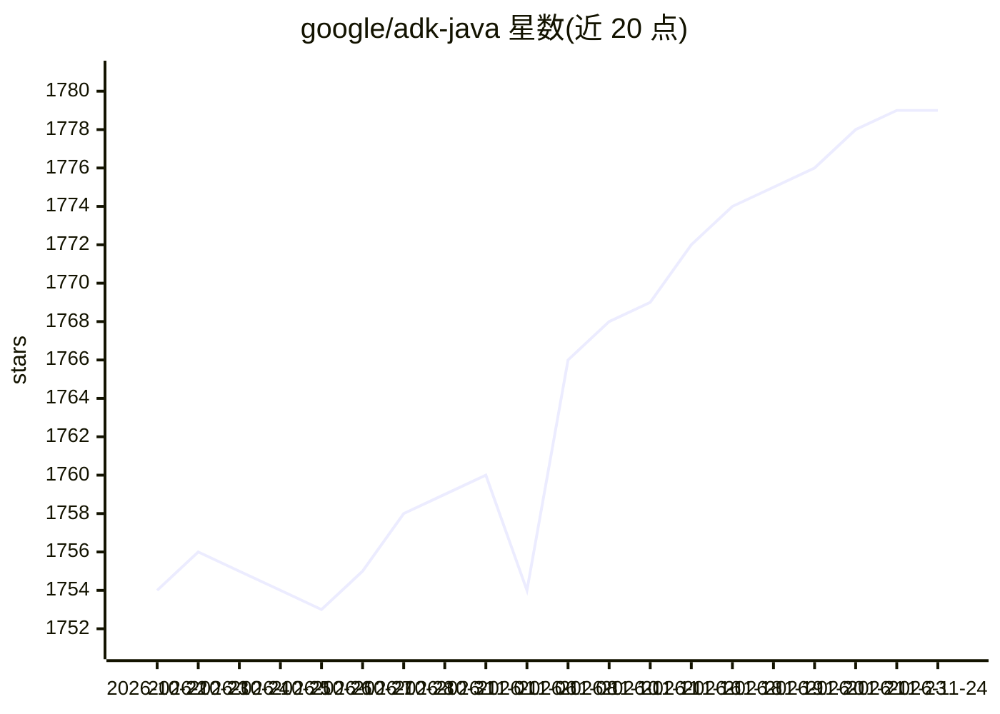

# google/adk-java

⭐ 1,779 · Java · Apache-2.0 · 推送 2026-11-23 · [GitHub](https://github.com/google/adk-java) · [官网](https://google.github.io/adk-docs/) · 组织维护

**面向开发者的 Java 代码优先 AI Agent 构建工具包**

Agent Development Kit (ADK) 的 Java 版本，供需要在构建高级 AI Agent 时获得细粒度控制与灵活性的开发者使用。支持在 Java 代码中直接定义 Agent 行为、编排与工具使用，便于调试、版本管理与部署。提供预构建工具、自定义函数、OpenAPI 规格接入的工具生态，支持将多个专用 Agent 组合为多 Agent 层级系统，并内置开发 UI 用于测试、评估与调试。与 Google Cloud 服务及 Python ADK 保持一致，Agent 评估功能尚未发布（标注 Coming soon）。

## 筛选速览

| 维度 | 判定 | 备注 |
|---|---|---|
| AI 角色 | `ai-ecosystem` | LLM/agent 周边工具 |
| 许可风险 | `permissive` | Apache-2.0 |
| 部署形态 | `None` |  |
| 模型依赖 | — | README 未给出锁定关系 |
| 硬件要求 | — | 无带数字的原话,不猜 |
| 安装摩擦 | `low` | 无编译、无系统依赖或容器化 |
| 成熟度 | — | 结构信号不足 |

## 能力要点

- 代码优先：在 Java 中直接定义 Agent 逻辑、工具与编排
- 模块化多 Agent 系统与丰富的工具生态（预构建工具/自定义函数/OpenAPI）
- 内置开发 UI 用于测试、评估、调试与展示 Agent
- 集成 A2A 协议实现远程 Agent 间通信

## 适用场景

- 用 Java 构建与 Google Cloud 服务深度集成的 AI Agent
- 组合多个专用 Agent 构建多 Agent 应用
- 使用开发 UI 调试与展示自己的 Agent
- 通过 A2A 协议实现 Agent 间远程通信

## 场景标签

`Agent 框架` `多智能体` · 领域:Agent 开发

## 证据(README 行号)

> L10:  An open-source, code-first Java toolkit for building, evaluating, and deploying sophisticated AI agents with flexi
> L19: Agent Development Kit (ADK) is designed for developers seeking fine-grained
> L20: control and flexibility when building advanced AI agents that are tightly

## 星数曲线

2026-10-22 1,754 → 2026-11-24 1,779（+25）

---
*卡片 v1 · prompt 1.4 · 生成 2026-11-23 · 置信度 high · 依据 README sha `f7d182b206d0` · [字段定义](../../DATASET.md)*
