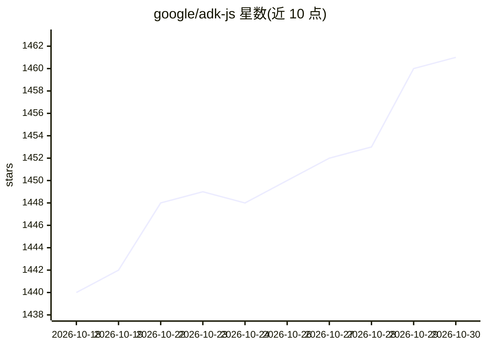

# google/adk-js

⭐ 1,461 · TypeScript · Apache-2.0 · 推送 2026-10-29 · [GitHub](https://github.com/google/adk-js) · [官网](https://adk.dev) · 组织维护

**Google 的 TypeScript AI agent 开发框架，构建/调试/部署多 agent 系统**

Google 开源的代码优先 TypeScript agent 开发工具包：以代码定义 agent 行为、编排与工具调用，支持顺序/并行/循环/路由的多 agent 编排、A2A 协议远程委派、MCP 服务器接入，内置 Google Search、Google Maps、Vertex AI Search 等工具。工具参数用 Zod v3/v4 校验，产出 ESM/CommonJS/Web 包，可在 Node.js 与浏览器运行。通过 npm 安装 SDK 与 devtools，CLI 提供 adk create/run/web/deploy 命令，需 Node.js ≥20.19。

## 筛选速览

| 维度 | 判定 | 备注 |
|---|---|---|
| AI 角色 | `ai-ecosystem` | LLM/agent 周边工具 |
| 许可风险 | `permissive` | Apache-2.0 |
| 部署形态 | `library` | 以包/库形式分发 |
| 模型依赖 | — | README 未给出锁定关系 |
| 硬件要求 | — | 无带数字的原话,不猜 |
| 安装摩擦 | `low` | 无编译、无系统依赖或容器化 |
| 成熟度 | — | 结构信号不足 |

## 能力要点

- 代码优先定义 agent，工具参数支持 Zod v3/v4 与编译期类型推断
- 顺序/并行/循环/路由多 agent 编排，A2A 协议远程委派
- 内置 Google Search / Maps / Vertex AI Search / URL context 工具，可接入 MCP 服务器
- CLI 含脚手架、本地测试与 Cloud Run 部署命令，附交互式开发 UI

## 适用场景

- 用 TypeScript 构建多 agent 工作流应用
- 在浏览器或 Node.js 中运行带工具调用的 agent
- 通过 CLI 脚手架、调试并部署 agent 到 Cloud Run

## 场景标签

`Agent 框架` `多智能体` · 领域:Agent 开发

## 证据(README 行号)

> L18: Agent Development Kit (ADK) is a flexible and modular framework for building,
> L20: multi-agent systems. Define agent behavior, orchestration, and tool use directly

## 星数曲线

2026-10-18 1,440 → 2026-10-30 1,461（+21）

---
*卡片 v1 · prompt 1.4 · 生成 2026-10-21 · 置信度 high · 依据 README sha `77c120525c63` · [字段定义](../../DATASET.md)*
