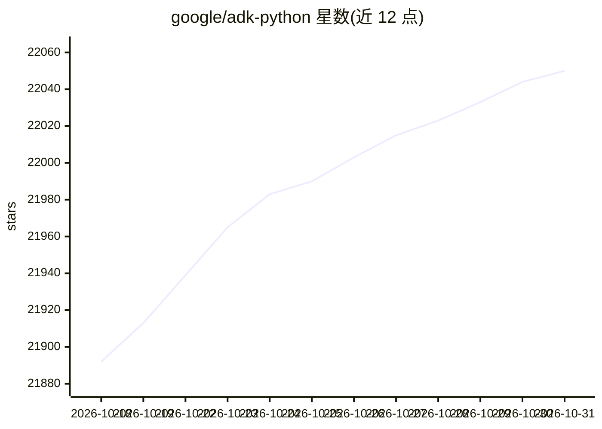

# google/adk-python

⭐ 22,050 · Python · Apache-2.0 · 推送 2026-10-30 · [GitHub](https://github.com/google/adk-python) · [官网](https://google.github.io/adk-docs/) · 组织维护

**面向开发者的代码优先 Python AI Agent 构建与部署框架**

Google 开源的 Python 工具包，将软件工程方法应用于 AI Agent 开发：提供图式执行引擎（支持路由、循环、状态管理、human-in-the-loop）、多 Agent 层级组合、Task API 结构化委派，以及覆盖预置工具/自定义函数/OpenAPI/MCP 的工具生态。代码优先定义 Agent，另支持无代码的 Agent Config。内置 CLI、Web 开发 UI 与评估命令；可容器化部署到 Cloud Run 或 Vertex AI Agent Engine。要求 Python 3.11+。

## 筛选速览

| 维度 | 判定 | 备注 |
|---|---|---|
| AI 角色 | `ai-native` | 本体是模型或模型工具 |
| 许可风险 | `permissive` | Apache-2.0 |
| 部署形态 | `library` | 以包/库形式分发 |
| 模型依赖 | — | README 未给出锁定关系 |
| 硬件要求 | — | 无带数字的原话,不猜 |
| 安装摩擦 | `low` | 无编译、无系统依赖或容器化 |
| 成熟度 | — | 结构信号不足 |

## 动量与使用信号

- 维护:`active` — 距上次 push 0.6 天,年发版 63,430 位贡献者
- 涨星:近 1 天 **+14**(自 20261016 起算)
- 安装:pypi 包 `google-adk` 月下载 10,109,331
- 平台:— · 协议:MCP

## 能力要点

- 图式工作流引擎：路由、fan-out/fan-in、循环、重试、状态管理、human-in-the-loop
- 模块化多 Agent 系统与 Task API 结构化委派
- 工具生态覆盖预置工具、自定义函数、OpenAPI、MCP
- 内置开发 UI、评估命令与 docker/cloud_run 部署命令

## 适用场景

- 用 Python 代码构建并编排多 Agent 工作流
- 本地或云端部署并调试 AI Agent 应用
- 对 Agent 行为进行评估测试

## 场景标签

`Agent 框架` `多智能体` · 领域:Agent 开发

## 证据(README 行号)

> L12:  An open-source, code-first Python framework for building, evaluating, and deploying sophisticated AI agents with f
> L25: Agent Development Kit (ADK) is a flexible and modular framework that applies
> L28: tasks to complex systems. While optimized for Gemini, ADK is model-agnostic,

## 星数曲线

2026-10-18 21,892 → 2026-10-31 22,050（+158）

---
*卡片 v1 · prompt 1.4 · 生成 2026-10-18 · 置信度 high · 依据 README sha `17181f54bb09` · [字段定义](../../DATASET.md)*
