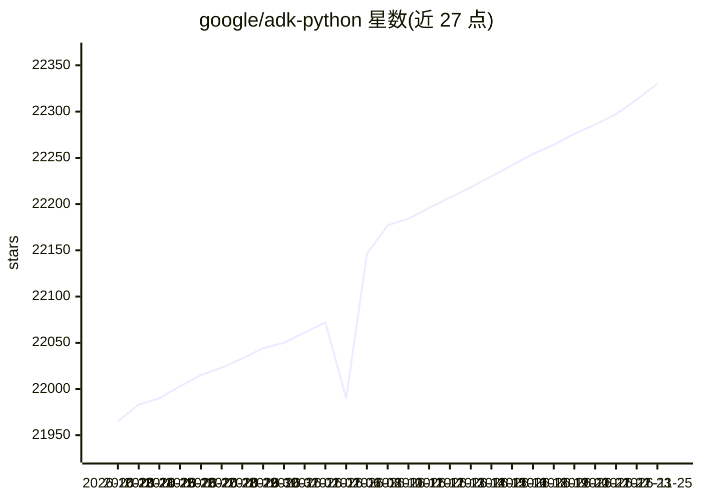

# google/adk-python

⭐ 22,330 · Python · Apache-2.0 · 推送 2026-11-24 · [GitHub](https://github.com/google/adk-python) · [官网](https://google.github.io/adk-docs/) · 组织维护

**面向开发者的构建、评估与部署 AI Agent 的 Python 框架**

Agent Development Kit（ADK）是 Google 维护的开源、代码优先 Python 框架，覆盖 Agent 的构建、评估与部署全流程。核心机制包括：图执行引擎支持路由、扇出/扇入、循环、重试、状态管理与人在环；Task API 提供结构化 Agent 间委托；可组合多 Agent 层次结构，工具生态支持预构建工具、自定义函数、OpenAPI 规范与 MCP 工具。对 Gemini 做了优化，同时模型无关、部署无关。要求 Python 3.11+，附带内置开发 UI 与 adk CLI（运行、Web UI、评估、部署）。

## 筛选速览

| 维度 | 判定 | 备注 |
|---|---|---|
| AI 角色 | `ai-ecosystem` | LLM/agent 周边工具 |
| 许可风险 | `permissive` | Apache-2.0 |
| 部署形态 | `library` | 以包/库形式分发 |
| 模型依赖 | — | README 未给出锁定关系 |
| 硬件要求 | — | 无带数字的原话,不猜 |
| 安装摩擦 | `low` | 无编译、无系统依赖或容器化 |
| 成熟度 | — | 结构信号不足 |

## 动量与使用信号

- 维护:`active` — 距上次 push 0.6 天,年发版 63,430 位贡献者
- 涨星:近 1 天 **+14**(自 20261016 起算)
- 安装:pypi 包 `google-adk` 月下载 10,109,331
- 平台:— · 协议:MCP

## 能力要点

- 图执行引擎：路由、扇出/扇入、循环、重试、状态管理与人在环
- Task API 结构化 Agent 间委托，支持多轮任务与单轮受控输出
- 工具生态：预构建工具、自定义函数、OpenAPI 规范与 MCP 工具
- 内置开发 UI 用于测试、评估、调试 Agent，adk eval 提供评估样例

## 适用场景

- 用 Python 代码优先的方式构建多 Agent 工作流
- 容器化部署 Agent 到 Cloud Run 或本地 Docker
- 用评估集对 Agent 行为做自动化评测

## 场景标签

`Agent 框架` `多智能体` `模型评测` · 领域:Agent 开发

## 证据(README 行号)

> L12:  An open-source, code-first Python framework for building, evaluating, and deploying sophisticated AI agents with f
> L25: Agent Development Kit (ADK) is a flexible and modular framework that applies
> L28: tasks to complex systems. While optimized for Gemini, ADK is model-agnostic,

## 星数曲线

2026-10-23 21,965 → 2026-11-25 22,330（+365）

---
*卡片 v1 · prompt 1.4 · 生成 2026-11-22 · 置信度 high · 依据 README sha `af322adde6ad` · [字段定义](../../DATASET.md)*
