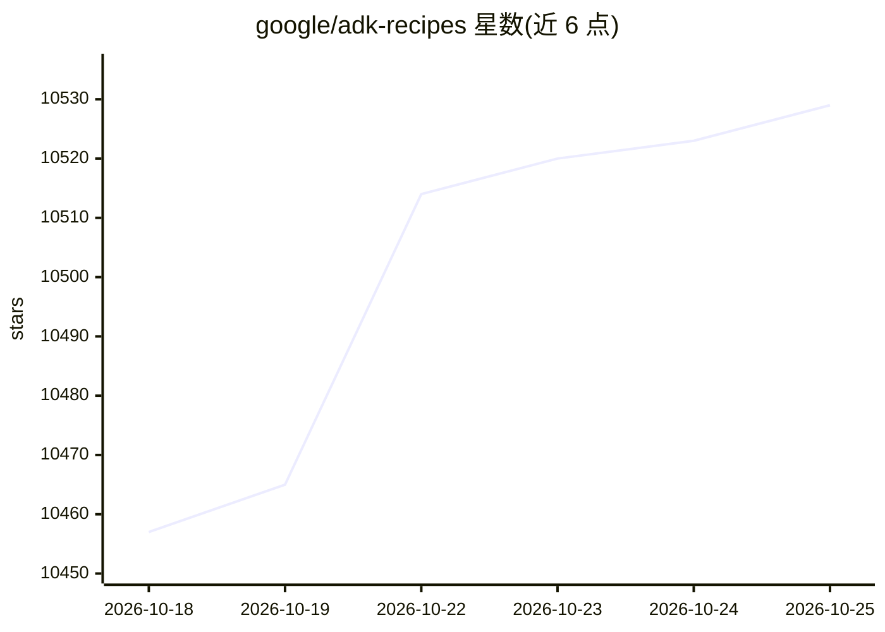

# google/adk-recipes

⭐ 10,529 · Python · Apache-2.0 · 推送 2026-10-23 · [GitHub](https://github.com/google/adk-recipes) · [官网](https://adk.dev) · 组织维护

**基于 Google ADK 的 agent 示例配方与垂直插件集合**

Google 维护的 Agent Development Kit (ADK) 配方集合：收录小型可运行的 agent 示例，演示 OAuth 流程、会话记忆、护栏、RAG 模式等常见问题的解法。仓库分三层组织：core/ 为官方团队精选的通用模式，contrib/ 为社区与垂直领域可部署 agent（可部署到 Gemini Enterprise Agent Platform、Cloud Run 等），plugins/ 为领域技能插件（含 SKILL.md 与 EVAL.yaml）。每个配方含独立 README 的安装运行说明，声明为示例起点而非生产用途，非官方支持的 Google 产品。

## 筛选速览

| 维度 | 判定 | 备注 |
|---|---|---|
| AI 角色 | `ai-knowledge` | 知识聚合/清单类 |
| 许可风险 | `permissive` | Apache-2.0 |
| 部署形态 | `None` |  |
| 模型依赖 | — | README 未给出锁定关系 |
| 硬件要求 | — | 无带数字的原话,不猜 |
| 安装摩擦 | `low` | 无编译、无系统依赖或容器化 |
| 成熟度 | — | 结构信号不足 |

## 能力要点

- core/contrib/plugins 三层组织：模式示例、可部署垂直 agent、技能插件
- 支持 ADK 的 Python/TypeScript/Go/Java/Kotlin 多语言 SDK
- 每个配方含独立 setup 与 run 说明
- 提供 Recipe Checklist 与 Recipe Handbook 贡献指引

## 适用场景

- 寻找 ADK agent 开发起点，fork 配方快速启动项目
- 学习 OAuth、session memory、guardrails、RAG 等 agent 模式
- 零售等垂直场景直接部署现成 agent（如商品搜索、虚拟试穿）

## 场景标签

`教程课程` · 领域:学习与行业

## 证据(README 行号)

> L5: Welcome. This is a public collection of ADK recipes — small,
> L6: runnable agents that show how to solve real problems with the

## 星数曲线

2026-10-18 10,457 → 2026-10-25 10,529（+72）

---
*卡片 v1 · prompt 1.4 · 生成 2026-10-20 · 置信度 high · 依据 README sha `0ebd86003d39` · [字段定义](../../DATASET.md)*
