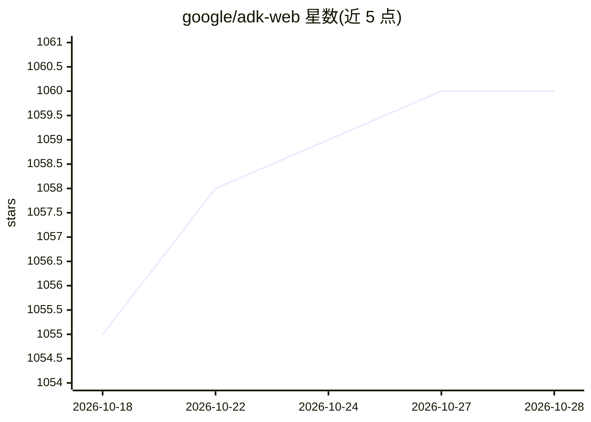

# google/adk-web

⭐ 1,060 · TypeScript · Apache-2.0 · 推送 2026-10-08 · [GitHub](https://github.com/google/adk-web) · [官网](https://google.github.io/adk-docs/) · 组织维护

**Google ADK 内置的开发者 Web UI，用于 agent 开发调试**

Google Agent Development Kit (ADK) 自带的前端开发者界面，供开发者在浏览器中开发与调试 AI agent，包含事件查看、Tracing、Artifacts、Evaluations 评测与 Agent builder/assistant 等视图。属于 ADK 框架的组成部分，需配合 google-adk（Python/Java）后端运行：前端用 npm install 与 npm run serve 启动 Angular 开发服务器，后端用 adk web 命令启动，开发服务器将 API 请求代理至后端。注意该项目处于 Pre-GA 阶段，按 Pre-GA 条款提供且支持有限。

## 筛选速览

| 维度 | 判定 | 备注 |
|---|---|---|
| AI 角色 | `ai-ecosystem` | LLM/agent 周边工具 |
| 许可风险 | `permissive` | Apache-2.0 |
| 部署形态 | `library` | 以包/库形式分发 |
| 模型依赖 | — | README 未给出锁定关系 |
| 硬件要求 | — | 无带数字的原话,不猜 |
| 安装摩擦 | `low` | 无编译、无系统依赖或容器化 |
| 成熟度 | `idea` | |

## 能力要点

- 提供事件、Tracing、Artifacts、评测等调试视图
- 支持自定义前后端端口与远程后端（ADK_BACKEND 环境变量）
- Angular 前端 + adk web 后端，API 经开发服务器同源代理

## 适用场景

- 在浏览器中调试基于 ADK 构建的 agent
- 查看 agent 运行事件、追踪与评测结果
- 通过 Agent builder 界面搭建 agent

## 场景标签

`LLM 可观测性` `模型评测` · 领域:评测与运维

## 证据(README 行号)

> L8:  Agent Development Kit Web is the built-in developer UI that integrated with Google Agent Development Kit for easier
> L16: Agent Development Kit (ADK) is a flexible and modular framework for developing and deploying AI agents. While optim
> L18: ADK web is the built-in dev UI that comes along with adk for easier development and debug.

## 星数曲线

2026-10-18 1,055 → 2026-10-28 1,060（+5）

---
*卡片 v1 · prompt 1.4 · 生成 2026-10-21 · 置信度 high · 依据 README sha `d6353979872e` · [字段定义](../../DATASET.md)*
