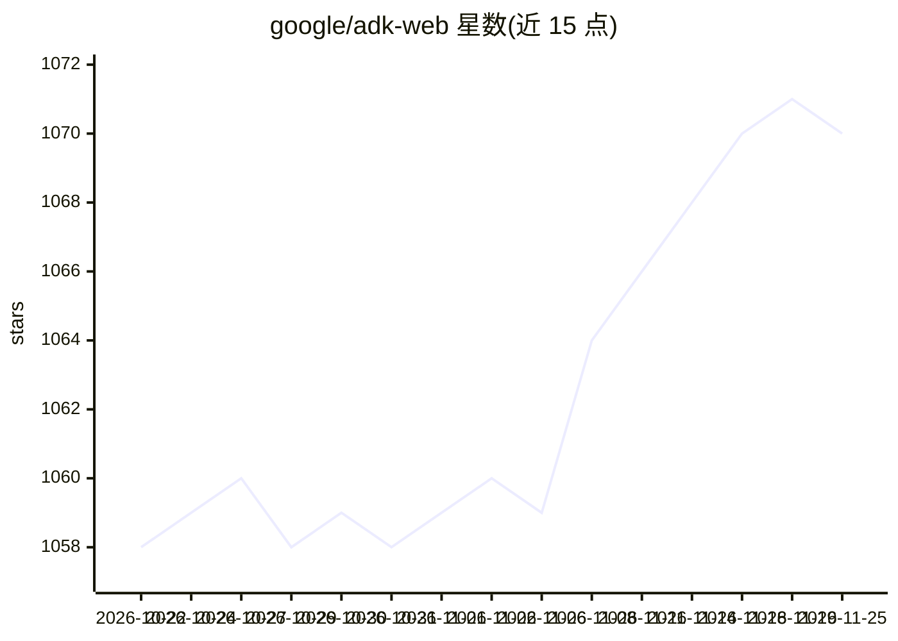

# google/adk-web

⭐ 1,070 · TypeScript · Apache-2.0 · 推送 2026-11-18 · [GitHub](https://github.com/google/adk-web) · [官网](https://google.github.io/adk-docs/) · 组织维护

**ADK 内置的 agent 开发调试 Web UI**

Google Agent Development Kit 的内置开发者界面，以 Angular 前端形式随 ADK 提供，用于 agent 的开发与调试。界面功能覆盖事件查看、Tracing 追踪、Artifacts 与 Evaluations 评估等模块。前端通过 dev server 将 API 调用代理到后端，前后端端口可分离配置（ADK_BACKEND/--port），支持连接远程后端。需 Node.js/npm/Angular CLI 环境及 Python 或 Java 版 google-adk 配合运行。当前为 Pre-GA 阶段功能。

## 筛选速览

| 维度 | 判定 | 备注 |
|---|---|---|
| AI 角色 | `ai-ecosystem` | LLM/agent 周边工具 |
| 许可风险 | `permissive` | Apache-2.0 |
| 部署形态 | `library` | 以包/库形式分发 |
| 模型依赖 | — | README 未给出锁定关系 |
| 硬件要求 | — | 无带数字的原话,不猜 |
| 安装摩擦 | `low` | 无编译、无系统依赖或容器化 |
| 成熟度 | `idea` | |

## 能力要点

- 与 ADK 集成的内置开发调试 UI
- 提供事件、Tracing、Artifacts、Evaluations 等界面模块
- dev server 代理 API 调用，前后端端口可分离并支持远程后端

## 适用场景

- 本地开发 ADK agent 时进行交互调试
- 通过 tracing 查看 agent 执行链路
- 对 agent 运行做事件与评估检查

## 场景标签

`LLM 可观测性` · 领域:评测与运维

## 证据(README 行号)

> L8:  Agent Development Kit Web is the built-in developer UI that integrated with Google Agent Development Kit for easier
> L16: Agent Development Kit (ADK) is a flexible and modular framework for developing and deploying AI agents. While optim
> L18: ADK web is the built-in dev UI that comes along with adk for easier development and debug.

## 星数曲线

2026-10-22 1,058 → 2026-11-25 1,070（+12）

---
*卡片 v1 · prompt 1.4 · 生成 2026-11-24 · 置信度 high · 依据 README sha `762178e5d92f` · [字段定义](../../DATASET.md)*
