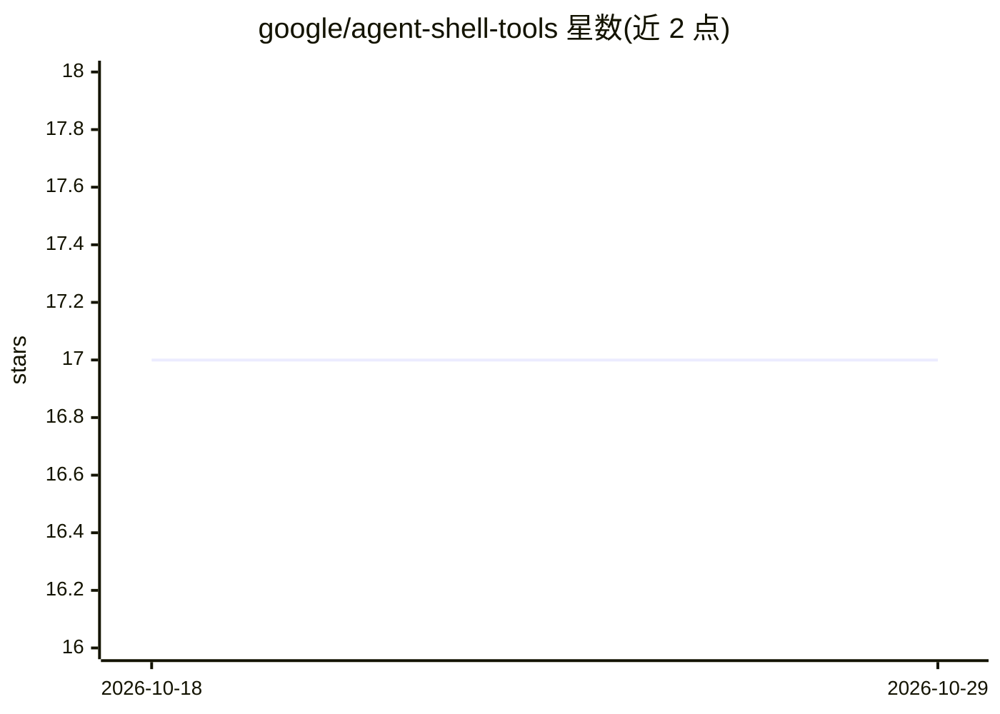

# google/agent-shell-tools

⭐ 17 · Go · Apache-2.0 · 推送 2026-06-08 · [GitHub](https://github.com/google/agent-shell-tools) · 组织维护

**让编码 agent 安全访问 shell 的工具集（沙箱/过滤/执行/代理）**

Google 仓库下的四个组件：nsjail 沙箱（以容器边界为安全模型）、host 侧命令规则过滤语言 command_filter、经 Unix 套接字流式执行命令的 gRPC 服务 grpc_exec、以及用于开发测试 MCP 服务器的 mcpmux 代理。支持 agent 在沙箱内或沙箱外两种组合模式；文件访问明确不在范围内。构建与测试通过 Bazel 进行，可打包为 tarball 分发。声明非官方支持产品，Apache-2.0 许可。

## 筛选速览

| 维度 | 判定 | 备注 |
|---|---|---|
| AI 角色 | `ai-ecosystem` | LLM/agent 周边工具 |
| 许可风险 | `permissive` | Apache-2.0 |
| 部署形态 | `None` |  |
| 模型依赖 | — | README 未给出锁定关系 |
| 硬件要求 | — | 无带数字的原话,不猜 |
| 安装摩擦 | `low` | 无编译、无系统依赖或容器化 |
| 成熟度 | — | 结构信号不足 |

## 能力要点

- nsjail 沙箱以容器边界为安全模型，隔离宿主凭证与文件系统
- command_filter 规则语言窄授权宿主侧 CLI 能力
- gRPC 服务经 Unix 套接字流式执行命令
- mcpmux 支持 MCP 服务器编辑-启动-测试闭环

## 适用场景

- 让编码 agent 在受控沙箱中执行 shell 命令
- 细粒度授权 agent 可用的宿主侧命令
- 开发并测试自建 MCP 服务器

## 场景标签

`Agent 框架` `网络安全` · 领域:Agent 开发

## 证据(README 行号)

> L3: Tools to let coding agents access the shell with opinionated defaults.
> L17: - **`mcpmux`** — MCP proxy for developing and testing MCP servers.

## 星数曲线

2026-10-18 17 → 2026-10-29 17（+0）

---
*卡片 v1 · prompt 1.4 · 生成 2026-10-29 · 置信度 high · 依据 README sha `382d2812c792` · [字段定义](../../DATASET.md)*
