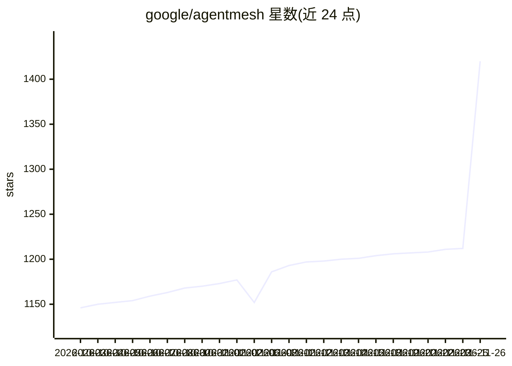

# google/agentmesh

⭐ 1,420 · Go · Apache-2.0 · 推送 2026-11-25 · [GitHub](https://github.com/google/agentmesh) · [官网](https://google.github.io/agentmesh/) · 组织维护

**给 AI agent 搭建私有网络的节点/控制面工具**

Agent Mesh 为 AI agent 提供私有组网能力：节点运行在 agent 旁边，支持向网络发布工具与模型、发现并调用其他节点发布的服务，以及可验证的节点身份。默认不可达、按服务名授权，身份通过 OpenID Connect 或 bootstrap token 注册并由控制面签发短期凭证；节点间可直连或经 router 中继，覆盖笔记本、容器、集群与 NAT 后设备。组件含 control-plane、router、node 与 all-in-one 的 one，并提供本地 MCP server 与 OpenAI 兼容端点。

## 筛选速览

| 维度 | 判定 | 备注 |
|---|---|---|
| AI 角色 | `ai-ecosystem` | LLM/agent 周边工具 |
| 许可风险 | `permissive` | Apache-2.0 |
| 部署形态 | `None` |  |
| 模型依赖 | — | README 未给出锁定关系 |
| 硬件要求 | — | 无带数字的原话,不猜 |
| 安装摩擦 | `low` | 无编译、无系统依赖或容器化 |
| 成熟度 | `idea` | |

## 能力要点

- 节点身份通过 OIDC/bootstrap token 注册并签发短期离线可验证凭证
- 默认不可达、按服务名授权的零信任策略模型
- 本地 MCP server 与 OpenAI 兼容端点接入 agent
- 提供 agentmesh-one 单二进制（控制面+router+web 控制台）

## 适用场景

- 让多台设备上的 agent 互相发现并调用工具服务
- 在自有控制面上组建私有 agent 网络
- 通过 Kubernetes/Cloud Run 部署 mesh 组件

## 场景标签

 · 领域:AI 基础设施/agent 组网

## 证据(README 行号)

> L5: **Agent Mesh** is a private network for AI agents. A
> L56: |`agentmesh-node`|Runs next to your agent or service. Enrolls, connects, serves your local backends to the mesh, an

## 星数曲线

2026-10-23 1,146 → 2026-11-26 1,420（+274）

---
*卡片 v1 · prompt 1.4 · 生成 2026-11-23 · 置信度 high · 依据 README sha `271ac397ecdf` · [字段定义](../../DATASET.md)*
