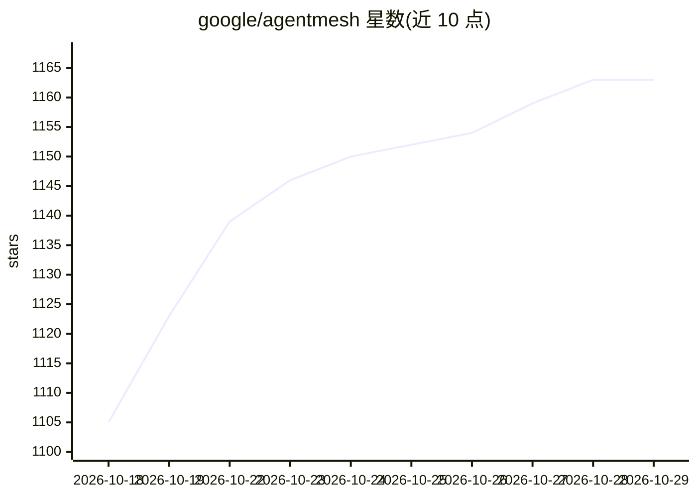

# google/agentmesh

⭐ 1,163 · Go · Apache-2.0 · 推送 2026-10-27 · [GitHub](https://github.com/google/agentmesh) · [官网](https://google.github.io/agentmesh/) · 组织维护

**给 AI agent 的私有网络：节点间发布、发现与调用工具和模型**

在每个 agent 旁运行节点，提供三项能力：向网络发布工具与模型、查找并调用其他节点发布的内容、以及各节点可验证的身份。节点可直连时直连，不能直连时经 router 中继，可跨笔记本、容器、集群与 NAT 后手机工作。默认不暴露任何服务，授权按服务名而非地址评估；身份来自 OpenID Connect 或一次性引导 token，由控制平面签发短期离线可验证凭证。组件含 control-plane、router、node 与一体化 binary agentmesh-one，向 agent 以本地 MCP server 与 OpenAI 兼容 API 形式暴露 mesh。项目处于 pre-1.0，沙箱 agent 蓝图与移动应用为预览状态。

## 筛选速览

| 维度 | 判定 | 备注 |
|---|---|---|
| AI 角色 | `ai-ecosystem` | LLM/agent 周边工具 |
| 许可风险 | `permissive` | Apache-2.0 |
| 部署形态 | `None` |  |
| 模型依赖 | — | README 未给出锁定关系 |
| 硬件要求 | — | 无带数字的原话,不猜 |
| 安装摩擦 | `low` | 无编译、无系统依赖或容器化 |
| 成熟度 | `idea` | |

## 能力要点

- 节点以本地 MCP server 与 OpenAI 兼容 API 暴露 mesh 服务
- 默认零可达：基于服务名的策略授权，未授权不可调用
- OIDC/引导 token 注册，签发与节点密钥绑定的短期离线可验证凭证
- 直连与中继混合组网，覆盖 NAT 后设备；提供一体化 agentmesh-one 单 binary

## 适用场景

- 让我的 agent 跨机器安全发现并调用其他节点发布的工具和模型
- 在笔记本或小规模部署上用单 binary 搭建私有 agent 网络
- 把模型请求路由到 mesh 内提供该模型的节点

## 场景标签

`模型网关` · 领域:Agent 开发

## 证据(README 行号)

> L5: **Agent Mesh** is a private network for AI agents. A
> L6: node runs next to an agent and gives it three things: a way to publish tools
> L56: |`agentmesh-node`|Runs next to your agent or service. Enrolls, connects, serves your local backends to the mesh, an

## 星数曲线

2026-10-18 1,105 → 2026-10-29 1,163（+58）

---
*卡片 v1 · prompt 1.4 · 生成 2026-10-21 · 置信度 high · 依据 README sha `41bd87c8c399` · [字段定义](../../DATASET.md)*
