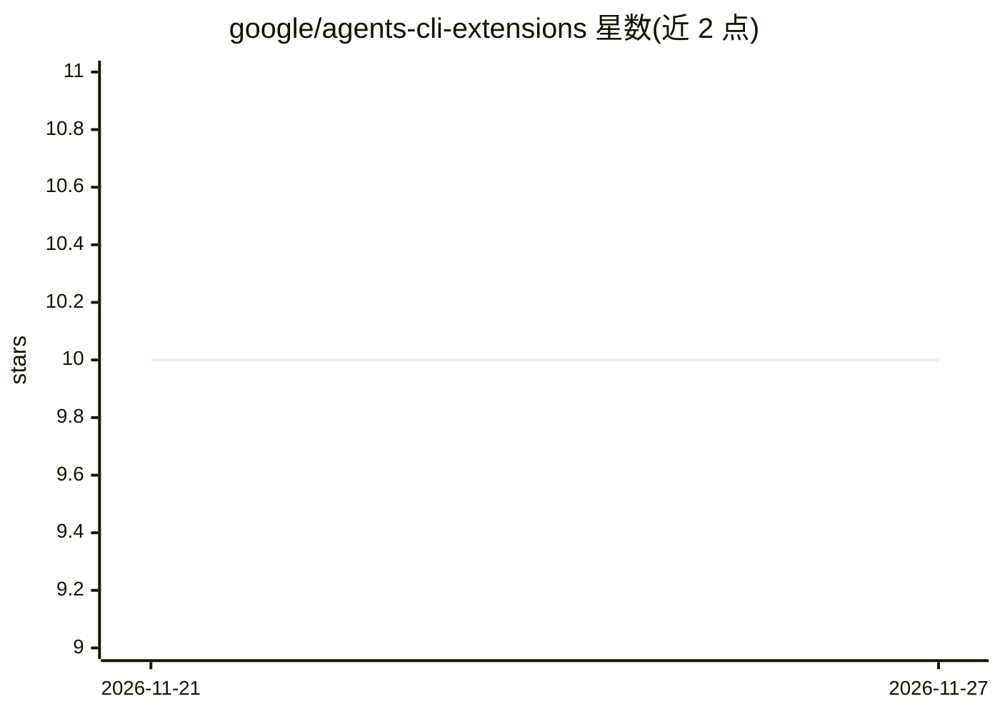

# google/agents-cli-extensions

⭐ 10 · Python · Apache-2.0 · 推送 2026-11-24 · [GitHub](https://github.com/google/agents-cli-extensions) · 组织维护

**agents-cli 的官方扩展集合：接入其他 agent 框架**

Google Agents CLI 团队维护的扩展仓库，扩展机制通过覆盖或新增 agents-cli 命令，使脚手架、运行、评估、部署的 agent 开发生命周期支持 CLI 本身未内置的框架。目前提供两个 Experimental 扩展：Claude（运行 Claude Agent SDK agents）与 LangChain（运行 LangChain agents、LangGraph 图与 Deep Agents）。扩展可按项目或全局（用户级）作用域安装，经 PyPI 或 GitHub 引用分发，带 list/update/remove/info 等管理命令与冲突检测。

## 筛选速览

| 维度 | 判定 | 备注 |
|---|---|---|
| AI 角色 | `ai-ecosystem` | LLM/agent 周边工具 |
| 许可风险 | `permissive` | Apache-2.0 |
| 部署形态 | `library` | 以包/库形式分发 |
| 模型依赖 | locked-api |  |
| 硬件要求 | — | 无带数字的原话,不猜 |
| 安装摩擦 | `medium` | 含编译或系统依赖之一 |
| 成熟度 | — | 结构信号不足 |

## 能力要点

- 通过命令覆盖机制让 agents-cli 生命周期支持第三方框架
- 提供 Claude Agent SDK 与 LangChain/LangGraph/Deep Agents 两个扩展
- 支持项目作用域与全局作用域安装，项目作用域优先
- 提供 extension list/update/remove/info 等管理与冲突报告命令

## 适用场景

- 用 agents-cli 的统一命令管理 LangChain/LangGraph 项目
- 在 agents-cli 生命周期中运行 Claude Agent SDK agents
- 为 agents-cli 开发自定义命令扩展

## 场景标签

`Agent 框架` · 领域:Agent 开发

## 证据(README 行号)

> L13: An extension overrides or adds `agents-cli` commands, so the agent development lifecycle (scaffold, run, evaluate, 
> L19: |Claude|Run Claude Agent SDK agents through the `agents-cli` lifecycle.|Experimental|

## 星数曲线

2026-11-21 10 → 2026-11-27 10（+0）

---
*卡片 v1 · prompt 1.4 · 生成 2026-11-21 · 置信度 high · 依据 README sha `89101026f272` · [字段定义](../../DATASET.md)*
