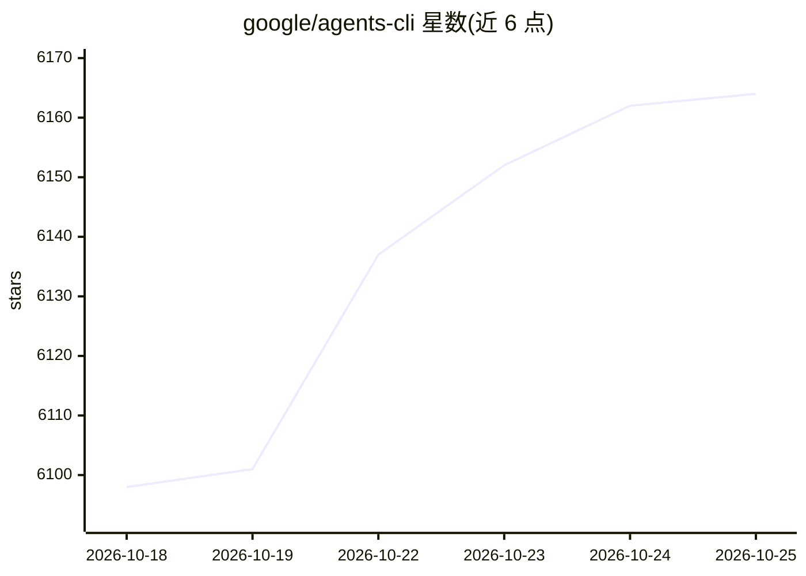

# google/agents-cli

⭐ 6,164 · Python · Apache-2.0 · 推送 2026-10-20 · [GitHub](https://github.com/google/agents-cli) · [官网](https://google.github.io/agents-cli/) · 组织维护

**让编程助手具备 Google Cloud ADK 智能体构建/评测/部署能力的 CLI 与技能包**

Google 官方维护的 CLI 与 agent 技能集合，配合 Antigravity CLI、Claude Code、Codex 等编程助手使用：为编程助手安装 7 个技能（工作流、ADK 代码、脚手架、评测、部署、发布、可观测性），并提供 create/run/eval/deploy/publish 等独立可用的命令行操作，覆盖 ADK 智能体从创建、评测（LLM-as-judge、失败模式聚类、提示词自动调优）到 Google Cloud 部署的全流程。本地开发可用 AI Studio API key，部署需 Google Cloud。CLI 本身不是编程助手，也可脱离编程助手独立运行。

## 筛选速览

| 维度 | 判定 | 备注 |
|---|---|---|
| AI 角色 | `ai-ecosystem` | LLM/agent 周边工具 |
| 许可风险 | `permissive` | Apache-2.0 |
| 部署形态 | `library` | 以包/库形式分发 |
| 模型依赖 | — | README 未给出锁定关系 |
| 硬件要求 | — | 无带数字的原话,不猜 |
| 安装摩擦 | `low` | 无编译、无系统依赖或容器化 |
| 成熟度 | — | 结构信号不足 |

## 能力要点

- 7 个技能覆盖 ADK 智能体开发全生命周期
- CLI 独立可用：create/run/eval/deploy/publish 等命令
- 评测体系含指标、数据集合成、LLM-as-judge 与失败模式聚类
- 本地开发可用 AI Studio API key，部署需 Google Cloud

## 适用场景

- 让 Claude Code 等编程助手直接生成和部署 ADK 智能体项目
- 为已有智能体项目补充 CI/CD 与部署配置
- 对智能体运行评测并根据结果调优提示词

## 场景标签

`代码生成` `模型评测` `Agent 框架` · 领域:Agent 开发

## 证据(README 行号)

> L16: **Agents CLI in Gemini platform** (`agents-cli`) gives your coding agent the skills and commands to build, scale, g
> L118: No. **`agents-cli` is a tool *for* coding agents, not a coding agent itself.** It provides the CLI commands and sk

## 星数曲线

2026-10-18 6,098 → 2026-10-25 6,164（+66）

---
*卡片 v1 · prompt 1.4 · 生成 2026-10-20 · 置信度 high · 依据 README sha `899c938e1898` · [字段定义](../../DATASET.md)*
