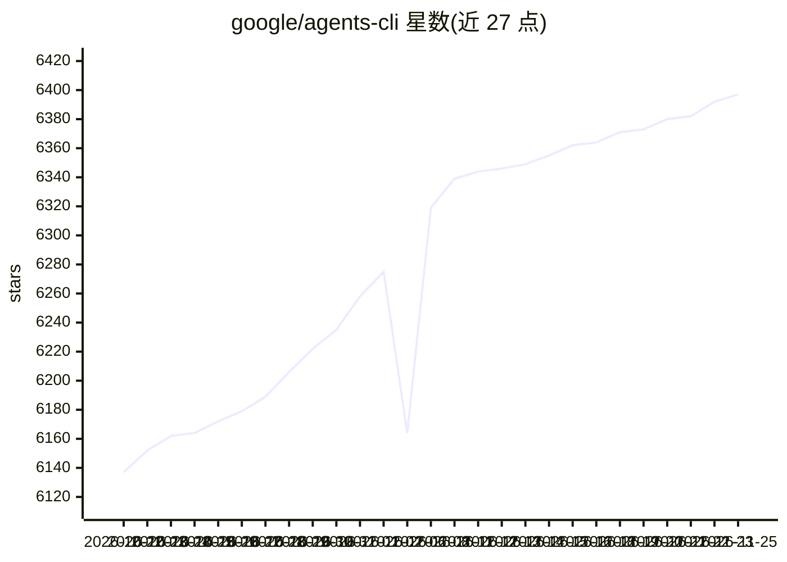

# google/agents-cli

⭐ 6,397 · Python · Apache-2.0 · 推送 2026-11-17 · [GitHub](https://github.com/google/agents-cli) · [官网](https://google.github.io/agents-cli/) · 组织维护

**让编码助手学会在 Google Cloud 上构建、评估、部署 AI Agent 的 CLI**

提供 CLI 命令与技能包，安装后供 Antigravity CLI、Claude Code、Codex 等编码助手调用，覆盖 ADK agent 项目的创建、脚手架、评估（含 LLM-as-judge 与数据集合成）、部署到 Agent Runtime/Cloud Run/GKE、发布与可观测性等环节；也可脱离编码助手独立在终端使用。前置条件为 Python 3.11+、uv、Node.js；本地开发可用 AI Studio API key，云端部署需 Google Cloud 项目，且默认向用户自己的 GCP 项目发送遥测（可关闭）。

## 筛选速览

| 维度 | 判定 | 备注 |
|---|---|---|
| AI 角色 | `ai-ecosystem` | LLM/agent 周边工具 |
| 许可风险 | `permissive` | Apache-2.0 |
| 部署形态 | `library` | 以包/库形式分发 |
| 模型依赖 | — | README 未给出锁定关系 |
| 硬件要求 | — | 无带数字的原话,不猜 |
| 安装摩擦 | `low` | 无编译、无系统依赖或容器化 |
| 成熟度 | — | 结构信号不足 |

## 能力要点

- 7 个技能覆盖 agent 开发全生命周期（脚手架/ADK 代码/评估/部署/发布/可观测性）
- eval 子命令集支持推理、评分、数据集合成、结果对比与失败模式聚类
- 兼容 Antigravity CLI、Claude Code、Codex 等编码助手，也可独立运行
- 默认遥测可经环境变量关闭，日志写入用户自己的 GCP 项目

## 适用场景

- 在 Google Cloud 上搭建并部署 ADK Python agent 项目
- 用评估数据集自动调优 agent 提示词并聚类失败模式
- 为已有 agent 项目补充部署与 CI/CD 配置

## 场景标签

`代码生成` · 领域:编码与开发

## 证据(README 行号)

> L16: **Agents CLI in Gemini platform** (`agents-cli`) gives your coding agent the skills and commands to build, scale, g
> L118: No. **`agents-cli` is a tool *for* coding agents, not a coding agent itself.** It provides the CLI commands and sk
> L121: ADK is an agent framework. `agents-cli` gives your coding agent the skills and tools to build, evaluate, and deplo

## 星数曲线

2026-10-22 6,137 → 2026-11-25 6,397（+260）

---
*卡片 v1 · prompt 1.4 · 生成 2026-11-22 · 置信度 mid · 依据 README sha `3289ba9705f9` · [字段定义](../../DATASET.md)*
