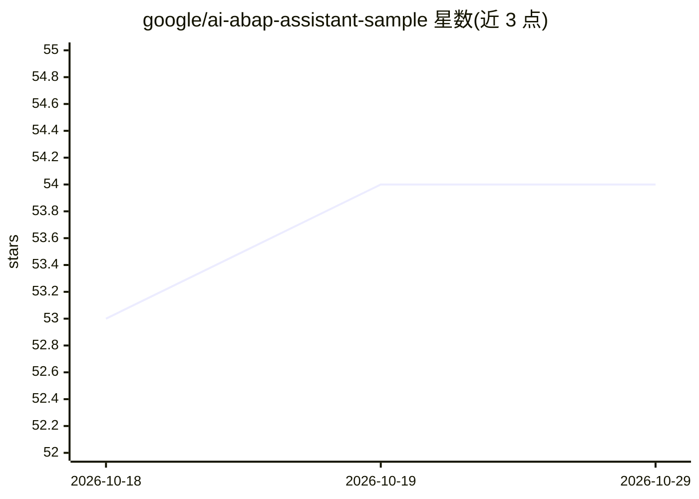

# google/ai-abap-assistant-sample

⭐ 54 · ABAP · Apache-2.0 · 推送 2026-09-18 · [GitHub](https://github.com/google/ai-abap-assistant-sample) · 组织维护

**为 SAP ABAP 开发者提供 AI 代码辅助的示例代码库**

该仓库提供 AI ABAP Assistant 的代码样本与相关工件。该工具将 Google Cloud Vertex AI（Gemini）接入 SAP GUI 与 Eclipse ADT，面向 ABAP 开发者，提供代码解释、代码审查、代码生成与 ABAP 单元测试建议等功能，通过右键菜单在开发环境内使用。前置条件为 SAP 系统安装 Google ABAP SDK 1.9 或更高版本，导入前需自行审查代码；仓库声明其中的代码不获 Google 官方支持。

## 筛选速览

| 维度 | 判定 | 备注 |
|---|---|---|
| AI 角色 | `ai-native` | 本体是模型或模型工具 |
| 许可风险 | `permissive` | Apache-2.0 |
| 部署形态 | `None` |  |
| 模型依赖 | — | README 未给出锁定关系 |
| 硬件要求 | — | 无带数字的原话,不猜 |
| 安装摩擦 | `low` | 无编译、无系统依赖或容器化 |
| 成熟度 | — | 结构信号不足 |

## 能力要点

- 将 Vertex AI（Gemini）集成到 SAP GUI 与 Eclipse ADT
- 支持代码解释、代码审查、代码建议与 ABAP 单元测试建议
- 通过右键菜单在 ABAP Editor 内使用

## 适用场景

- 在 ABAP Editor 中生成样板代码与单元测试
- 让 AI 解释复杂遗留 ABAP 逻辑
- 在开发环境内执行自动化代码审查

## 场景标签

`代码生成` `代码审查` · 领域:编码与开发

## 证据(README 行号)

> L7: |AI ABAP Assistant|The AI ABAP Assistant is an open-source tool that integrates Google Cloud's Vertex AI (Gemini) di
> L11:  - Your SAP system must have Google ABAP SDK version 1.9 or higher installed. If not, please follow the installatio

## 星数曲线

2026-10-18 53 → 2026-10-29 54（+1）

---
*卡片 v1 · prompt 1.4 · 生成 2026-10-24 · 置信度 high · 依据 README sha `f7d51744b175` · [字段定义](../../DATASET.md)*
