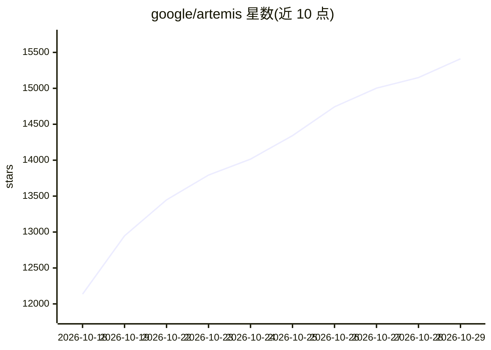

# google/artemis

⭐ 15,411 · Python · Apache-2.0 · 推送 2026-10-01 · [GitHub](https://github.com/google/artemis) · 组织维护 · 中文 README

**让 AI 助手与测试套件用自然语言驱动真机 Android 自动化**

Google 的 Android 自动化框架：将自然语言指令转化为跨应用 UI 操作，通过无障碍层级、OCR 与视觉模型定位元素，以 Flash（快反应式）与 Pro（探索/稳定性测试）两种模式执行，并采集 Logcat、截图与结构化结果。原生提供 MCP 服务器，可将真机接入 Antigravity、Claude Code、Windsurf 等 AI IDE；另有 Web 控制台、CLI 与零依赖 Python SDK。在 Google Research 的 AndroidWorld 基准上报告 99%+ 完成率。要求 Python 3.12+ 与连接的 Android 设备/模拟器。

## 筛选速览

| 维度 | 判定 | 备注 |
|---|---|---|
| AI 角色 | `ai-ecosystem` | LLM/agent 周边工具 |
| 许可风险 | `permissive` | Apache-2.0 |
| 部署形态 | `library` | 以包/库形式分发 |
| 模型依赖 | locked-api |  |
| 硬件要求 | — | 无带数字的原话,不猜 |
| 安装摩擦 | `medium` | 含编译或系统依赖之一 |
| 成熟度 | — | 结构信号不足 |

## 能力要点

- 自然语言驱动的跨应用 Android 自动化（Flash 每步约 3–5 秒）
- 原生 MCP 服务器接入 Antigravity / Claude Code / Windsurf 等 AI IDE
- Web 控制台、CLI、Python SDK（Pydantic 结构化输出）三种使用方式
- AndroidWorld 基准 100+ 多步任务报告 99%+ 完成率

## 适用场景

- 让 AI 编程助手在 IDE 中直接操作真机执行测试与诊断
- 用自然语言派发 Android UI 自动化测试任务并回放执行过程
- 将 Android 自动化接入 pytest 或 CI/CD 流水线

## 场景标签

`GUI 自动化` · 领域:效率与自动化

## 证据(README 行号)

> L27: * **IDE Diagnostics**: **Model Context Protocol (MCP)** integration lets **Antigravity, Claude Code, and Windsurf**
> L170: * **MCP Server**: Connects **Antigravity, Claude Code, Windsurf**, and other MCP clients to real devices for bug r
> L172: * **Python SDK**: Integrates as a standard Python library into existing automated testing frameworks (e.g., pytest

## 星数曲线

2026-10-18 12,136 → 2026-10-29 15,411（+3,275）

---
*卡片 v1 · prompt 1.4 · 生成 2026-10-20 · 置信度 mid · 依据 README sha `d5f3a7288483` · [字段定义](../../DATASET.md)*
