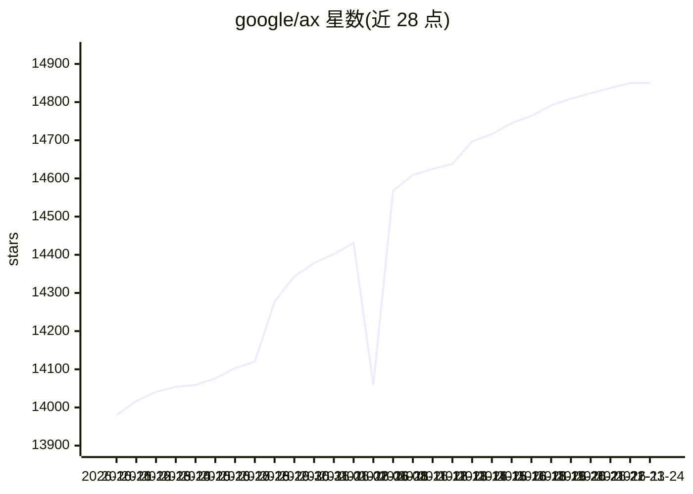

# google/ax

⭐ 14,850 · Go · Apache-2.0 · 推送 2026-11-22 · [GitHub](https://github.com/google/ax) · [官网](https://agentexecutor.io) · 组织维护

**Google 开源的集群级 agent 任务编排运行时**

AX 是一个声明式编排器，用于在集群上运行大量自主 agent 工作负载：以 ax.io/v1alpha1 YAML 声明 Task、Workspace、Model、Gateway 四类原语，提供沙箱隔离、CPU/内存限制、Git 仓库与 MCP 服务器预接线、凭据注入、挂起/恢复与 ssh 查看。CLI 形态仿照 kubectl（apply/get/describe/delete），通过 gRPC 与控制面通信，支持本地 Kind 集群与已有 Kubernetes 1.37+ 集群部署，并可配合本地 Web 应用 AX Studio 使用。目标用户是需要规模化运行与治理 agent 任务的平台/基础设施开发者。

## 筛选速览

| 维度 | 判定 | 备注 |
|---|---|---|
| AI 角色 | `ai-ecosystem` | LLM/agent 周边工具 |
| 许可风险 | `permissive` | Apache-2.0 |
| 部署形态 | `None` |  |
| 模型依赖 | — | README 未给出锁定关系 |
| 硬件要求 | — | 无带数字的原话,不猜 |
| 安装摩擦 | `low` | 无编译、无系统依赖或容器化 |
| 成熟度 | `idea` | |

## 动量与使用信号

- 维护:`active` — 距上次 push 1.5 天,年发版 7,22 位贡献者
- 涨星:近 1 天 **+188**(自 20261016 起算)
- 安装:github 包 `release-assets` 月下载无数据
- 平台:— · 协议:MCP

## 能力要点

- 声明式 YAML 定义 Task/Workspace/Model/Gateway 四类原语
- 沙箱隔离运行不可信 agent 代码并限制 CPU/内存
- ax suspend/resume 支持暂停与恢复任务状态
- kubectl 风格 CLI，支持 kubectx 多集群切换

## 适用场景

- 在集群上批量运行并治理自主 agent 任务
- 为不可信 agent 代码提供带资源限制的隔离沙箱
- 统一管理 agent 可访问的主机与注入凭据

## 场景标签

`Agent 框架` · 领域:Agent 开发

## 证据(README 行号)

> L9: **Declare an agentic task with workspaces and model specifications. AX sandboxes it, wires up its workspace, and hel
> L11: AX is a highly efficient, declarative orchestrator to run millions of autonomous agent workloads in a cluster. It r

## 星数曲线

2026-10-21 13,980 → 2026-11-24 14,850（+870）

---
*卡片 v1 · prompt 1.4 · 生成 2026-11-22 · 置信度 high · 依据 README sha `e9cf6dafa9c7` · [字段定义](../../DATASET.md)*
