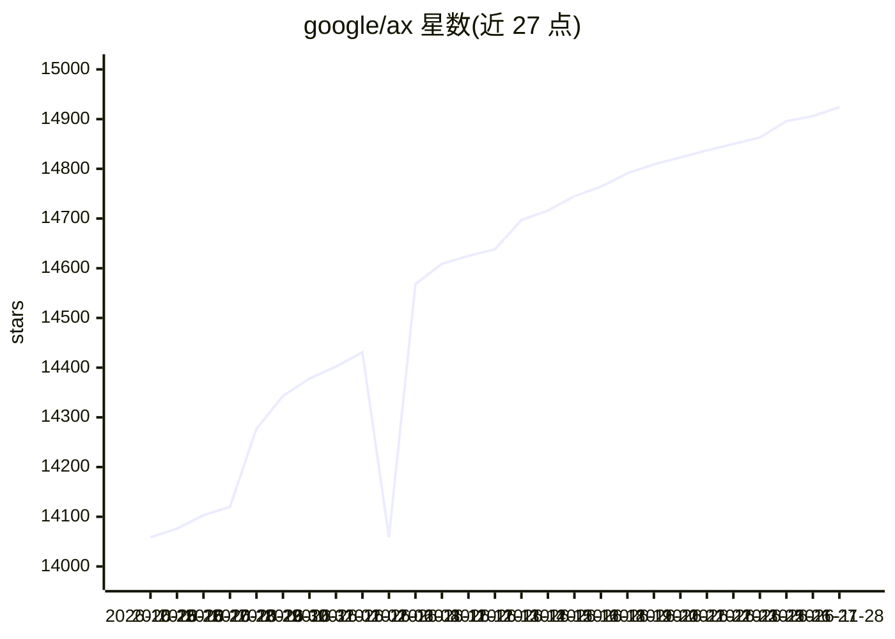

# google/ax

⭐ 14,924 · Go · Apache-2.0 · 推送 2026-11-27 · [GitHub](https://github.com/google/ax) · [官网](https://agentexecutor.io) · 组织维护

**Google 的 agent 工作负载编排运行时：声明式调度海量 agent 任务**

AX 是一个声明式编排器，用于在集群中运行数百万个自主 agent 工作负载，底层依赖 Agent Substrate 提供沙箱执行、调度、挂起/恢复与快照。核心原语包括 Task（隔离沙箱运行 agent 代码）、Workspace（预接线 Git 仓库/MCP 服务器/技能包）、Model（配置平台所用 LLM 凭证）、Gateway（网络出口与凭证注入）。通过 ax.io/v1alpha1 YAML 清单声明，CLI 呈 kubectl 风格（apply/get/describe/ssh），支持本地运行或安装到现有集群，并提供 ax studio 本地 Web 界面。README 标注项目处于活跃开发期，稳定版前可能出现重大破坏性变更。

## 筛选速览

| 维度 | 判定 | 备注 |
|---|---|---|
| AI 角色 | `ai-ecosystem` | LLM/agent 周边工具 |
| 许可风险 | `permissive` | Apache-2.0 |
| 部署形态 | `None` |  |
| 模型依赖 | — | README 未给出锁定关系 |
| 硬件要求 | — | 无带数字的原话,不猜 |
| 安装摩擦 | `low` | 无编译、无系统依赖或容器化 |
| 成熟度 | `idea` | |

## 动量与使用信号

- 维护:`active` — 距上次 push 1.5 天,年发版 7,22 位贡献者
- 涨星:近 1 天 **+188**(自 20261016 起算)
- 安装:github 包 `release-assets` 月下载无数据
- 平台:— · 协议:MCP

## 能力要点

- Task/Workspace/Model/Gateway 四个声明式原语，YAML 清单 + 单命令应用
- 沙箱隔离运行不可信 agent 代码，含 CPU/内存限制与出口策略
- 挂起/恢复/快照机制：暂停空闲 agent 并从原状态继续
- kubectl 风格 CLI，可跟随 Kubernetes context 切换集群，附 ax studio 本地 Web 界面

## 适用场景

- 在集群上批量运行需要隔离和状态管理的 agent 任务
- 为 agent 预配置代码仓库、MCP 服务器与技能包
- 集中管控 agent 的网络出口与模型凭证，避免凭证明文暴露给 agent
- 在本地开发后将任务原样提升到远程 GKE 集群运行

## 场景标签

`Agent 框架` · 领域:Agent 开发

## 证据(README 行号)

> L11: AX is a highly efficient, declarative orchestrator to run millions of autonomous agent workloads in a cluster. It r
> L31: Agents are a new kind of workload. They are neither stateless microservices nor run-to-completion batch jobs. They 
> L37: |Configure which LLM the platform itself uses, with credentials from a Kubernetes secret|**`Model`**|

## 星数曲线

2026-10-25 14,059 → 2026-11-28 14,924（+865）

---
*卡片 v1 · prompt 1.4 · 生成 2026-11-28 · 置信度 high · 依据 README sha `9b966bac3342` · [字段定义](../../DATASET.md)*
