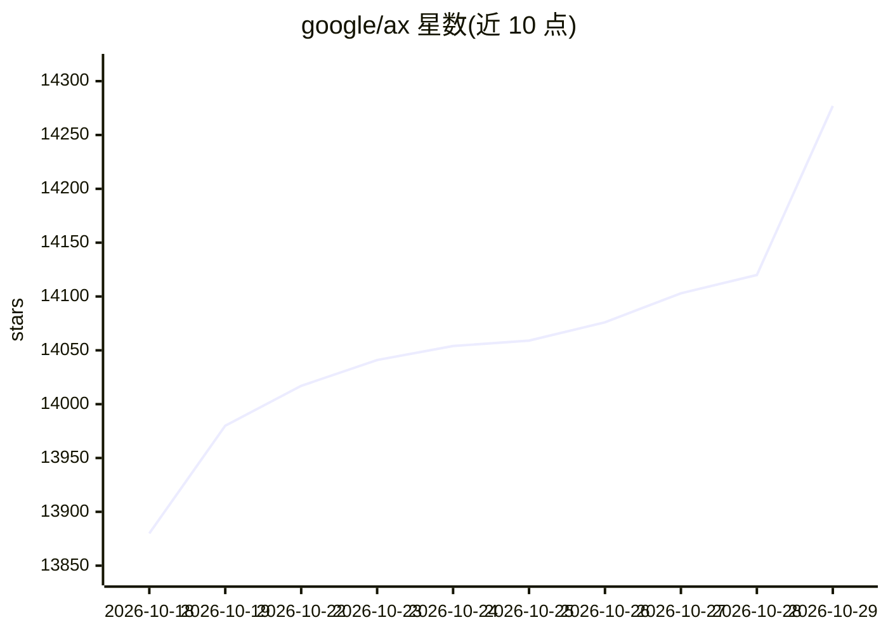

# google/ax

⭐ 14,277 · Go · Apache-2.0 · 推送 2026-10-28 · [GitHub](https://github.com/google/ax) · [官网](https://agentexecutor.io) · 组织维护

**Google 的声明式 Agent 编排运行时，在集群中大规模运行 agent 任务**

AX 是 Google 开源的声明式 agent 编排运行时，在 Kubernetes 集群上以 Agent Substrate 为沙箱执行层运行自主 agent 工作负载。核心原语为 Task（隔离沙箱运行不可信 agent 代码）、Workspace（预置 Git 仓库、MCP 服务器与技能包）、Model（配置平台使用的 LLM 及凭据），以 ax.io/v1alpha1 YAML 清单声明，通过 kubectl 风格的 CLI（apply/get/watch/ssh/suspend/resume）管理。CLI 用 go install 安装，控制面用 make deploy 部署，需自备集群、ko 与容器镜像仓库。README 声明项目处于重度开发阶段，可能引入破坏性变更。

## 筛选速览

| 维度 | 判定 | 备注 |
|---|---|---|
| AI 角色 | `ai-ecosystem` | LLM/agent 周边工具 |
| 许可风险 | `permissive` | Apache-2.0 |
| 部署形态 | `library` | 以包/库形式分发 |
| 模型依赖 | — | README 未给出锁定关系 |
| 硬件要求 | — | 无带数字的原话,不猜 |
| 安装摩擦 | `low` | 无编译、无系统依赖或容器化 |
| 成熟度 | `idea` | |

## 动量与使用信号

- 维护:`active` — 距上次 push 1.5 天,年发版 7,22 位贡献者
- 涨星:近 1 天 **+188**(自 20261016 起算)
- 安装:github 包 `release-assets` 月下载无数据
- 平台:— · 协议:MCP

## 能力要点

- Task/Workspace/Model 三原语，YAML 清单声明式管理 agent 任务
- 沙箱化执行，带 CPU/内存限制与 ax ssh 侵入查看、suspend/resume 暂停恢复
- kubectl 风格 CLI，支持多文档 YAML、kubectx 上下文切换
- 设计目标为单集群运行海量（billions of）agent 任务

## 适用场景

- 在 Kubernetes 集群中批量调度和隔离运行自主 agent
- 为 agent 预置 Git 仓库、MCP 服务器与技能包的启动环境
- 运维侧观察、暂停、恢复和排障运行中的 agent 任务

## 场景标签

`Agent 框架` `多智能体` · 领域:Agent 开发

## 证据(README 行号)

> L11: AX is a high-throughput, declarative orchestrator to run billions of autonomous agent workloads in a cluster. It ru
> L30: Agents are a new kind of workload. They are neither stateless microservices nor run-to-completion batch jobs. They 

## 星数曲线

2026-10-18 13,880 → 2026-10-29 14,277（+397）

---
*卡片 v1 · prompt 1.4 · 生成 2026-10-20 · 置信度 high · 依据 README sha `4562b59d520a` · [字段定义](../../DATASET.md)*
