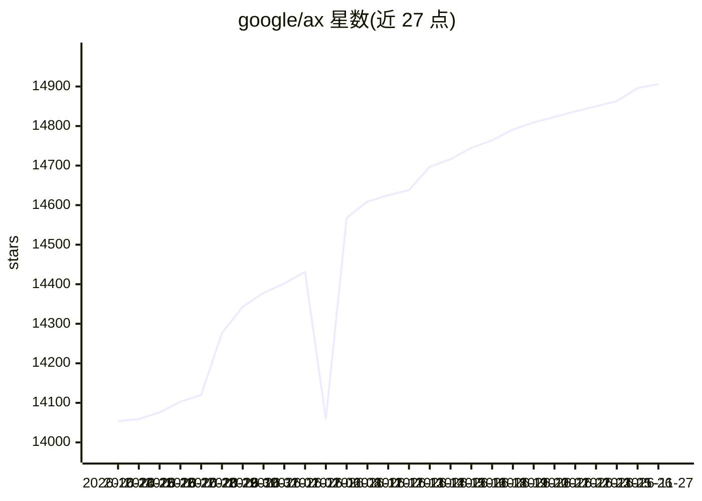

# google/ax

⭐ 14,906 · Go · Apache-2.0 · 推送 2026-11-26 · [GitHub](https://github.com/google/ax) · [官网](https://agentexecutor.io) · 组织维护

**给开发者在集群中声明式编排运行海量 agent 任务的运行时**

AX 是 Google 开源的 agent 编排运行时，通过 Task/Workspace/Model/Gateway 四类 YAML 原语声明 agent 工作负载：在沙箱中运行不可信 agent 代码、预配置 Git 仓库与 MCP 服务器、控制 LLM 凭据注入与网络出口策略。提供 kubectl 风格的 CLI（apply/get/describe/ssh/suspend/resume）、ax studio 本地 Web 界面与预构建 agent 镜像，底层依赖 Agent Substrate 计算层调度与隔离 actor，可本地运行或部署到集群。维护方声明项目处于重度开发阶段，稳定版前可能出现重大破坏性变更。

## 筛选速览

| 维度 | 判定 | 备注 |
|---|---|---|
| AI 角色 | `ai-ecosystem` | LLM/agent 周边工具 |
| 许可风险 | `permissive` | Apache-2.0 |
| 部署形态 | `None` |  |
| 模型依赖 | — | README 未给出锁定关系 |
| 硬件要求 | — | 无带数字的原话,不猜 |
| 安装摩擦 | `low` | 无编译、无系统依赖或容器化 |
| 成熟度 | `idea` | |

## 动量与使用信号

- 维护:`active` — 距上次 push 1.5 天,年发版 7,22 位贡献者
- 涨星:近 1 天 **+188**(自 20261016 起算)
- 安装:github 包 `release-assets` 月下载无数据
- 平台:— · 协议:MCP

## 能力要点

- 声明式 YAML（ax.io/v1alpha1）定义 Task、Workspace、Model、Gateway
- kubectl 风格 CLI：apply/get/describe/delete/ssh/suspend/resume
- agent 沙箱执行，支持挂起后精确恢复与快照 fan-out
- ax studio 本地 Web 界面与预构建 agent 镜像（如 Antigravity）

## 适用场景

- 在集群中以声明式方式批量运行数百万 agent 任务
- 为不可信 agent 代码提供带资源限制的隔离沙箱
- 集中管理 agent 可访问的主机与凭据注入
- 本地开发后无缝迁移任务到远程集群

## 场景标签

`Agent 框架` `多智能体` · 领域:Agent 开发

## 证据(README 行号)

> L9: **Declare an agentic task with workspaces and model specifications. AX sandboxes it, wires up its workspace, and hel
> L11: AX is a highly efficient, declarative orchestrator to run millions of autonomous agent workloads in a cluster. It r
> L31: Agents are a new kind of workload. They are neither stateless microservices nor run-to-completion batch jobs. They 

## 星数曲线

2026-10-24 14,054 → 2026-11-27 14,906（+852）

---
*卡片 v1 · prompt 1.4 · 生成 2026-11-27 · 置信度 high · 依据 README sha `cca8c34f5188` · [字段定义](../../DATASET.md)*
