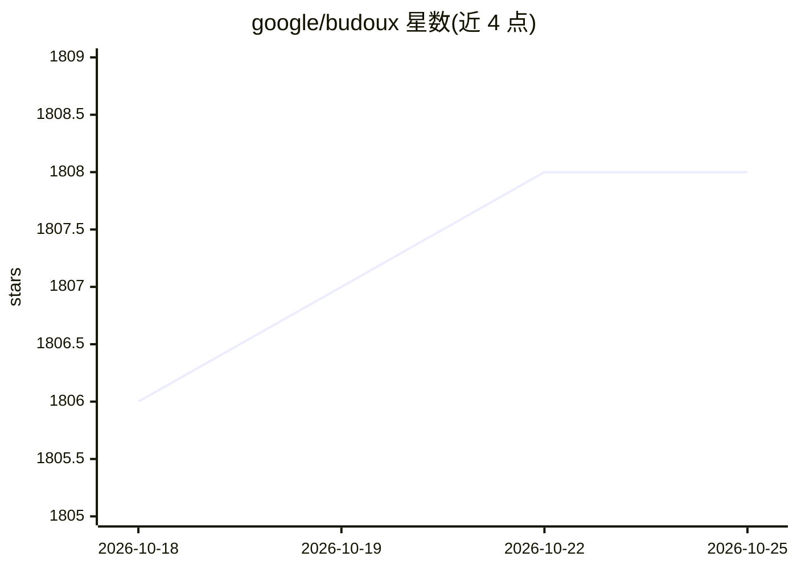

# google/budoux

⭐ 1,808 · Python · Apache-2.0 · 推送 2026-10-23 · [GitHub](https://github.com/google/budoux) · [官网](https://google.github.io/budoux/) · 组织维护

**CJK/泰文按语义短语的换行组织器，独立内置机器学习模型**

BudouX 是 Budou 的后继项目，用机器学习（AdaBoost 二分类）将句子切分为语义短语，并把 HTML 转换为用不断行标记包裹短语的输出，从而控制 CJK 等无空格语言的换行位置。提供 Python、JavaScript、Java 三种语言模块，含 CLI 命令。独立运行、无第三方分词器依赖，模型体积约 15KB，可在客户端使用。预置日语、简繁中文、泰语模型，也可用自有语料训练任意语言的自定义模型。注意：不做 HTML 净化，恶意输入会产出恶意输出。

## 筛选速览

| 维度 | 判定 | 备注 |
|---|---|---|
| AI 角色 | `ai-native` | 本体是模型或模型工具 |
| 许可风险 | `permissive` | Apache-2.0 |
| 部署形态 | `library` | 以包/库形式分发 |
| 模型依赖 | — | README 未给出锁定关系 |
| 硬件要求 | — | 无带数字的原话,不猜 |
| 安装摩擦 | `low` | 无编译、无系统依赖或容器化 |
| 成熟度 | — | 结构信号不足 |

## 能力要点

- AdaBoost 二分类预测字符间断点，模型仅约 15KB、无第三方依赖
- 预置日语/简体中文/繁体中文/泰语模型，支持自定义模型训练
- 支持 HTML 输入，输出以不断行标记包裹短语的 HTML 字符串
- 提供 Python/JavaScript/Java 模块与 Python CLI（budoux 命令）

## 适用场景

- 网页排版中防止 CJK 语句在词中间被随机断行
- 为无空格语言（日/中/泰）的文本插入语义换行点
- 用自己的语料为其他语言训练自定义分词换行模型

## 场景标签

 · 领域:NLP/网页排版

## 证据(README 行号)

> L7: BudouX is the successor to Budou, the machine learning powered line break organizer tool.
> L169: BudouX uses the AdaBoost algorithm to segment a sentence into phrases by considering the task as a binary classifi

## 星数曲线

2026-10-18 1,806 → 2026-10-25 1,808（+2）

---
*卡片 v1 · prompt 1.4 · 生成 2026-10-21 · 置信度 high · 依据 README sha `ea5a5db4d4a9` · [字段定义](../../DATASET.md)*
