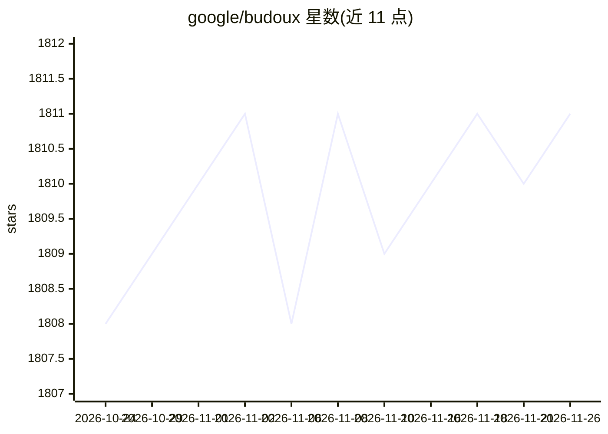

# google/budoux

⭐ 1,811 · Python · Apache-2.0 · 推送 2026-11-25 · [GitHub](https://github.com/google/budoux) · [官网](https://google.github.io/budoux/) · 组织维护

**面向网页开发者的轻量 CJK 断行整理工具**

BudouX 是 Budou 的后继版本，一个由机器学习驱动的断行整理工具：将 CJK 句子切分为词组并以不可断行标记包裹，输出 HTML 或短语列表，用于控制网页排版断行。内置自带的 AdaBoost 分词模型（含模型约 15 KB），不依赖第三方分词器或云端 API，预置日语、简繁中文、泰语模型，支持用任意语言训练数据构建自定义模型。提供 Python、JavaScript、Java 三种模块与 CLI；明确声明不可用作 HTML 消毒器。

## 筛选速览

| 维度 | 判定 | 备注 |
|---|---|---|
| AI 角色 | `ai-native` | 本体是模型或模型工具 |
| 许可风险 | `permissive` | Apache-2.0 |
| 部署形态 | `library` | 以包/库形式分发 |
| 模型依赖 | — | README 未给出锁定关系 |
| 硬件要求 | — | 无带数字的原话,不猜 |
| 安装摩擦 | `low` | 无编译、无系统依赖或容器化 |
| 成熟度 | — | 结构信号不足 |

## 能力要点

- 自带分词引擎，整体约 15 KB，可在客户端运行
- 预置日语、简繁中文、泰语模型，支持任意语言训练自定义模型
- 支持 HTML 输入，输出以零宽空格/标记包裹词组的 HTML
- 提供 Python/JavaScript/Java 模块及 CLI

## 适用场景

- 为中文或日文网页控制排版断行，避免词组被拆开
- 将解析器集成到客户端 JavaScript 中做前端断行处理
- 用自备语料为其他语言训练断行模型

## 场景标签

`模型训练` · 领域:训练与推理

## 证据(README 行号)

> L10: the machine learning powered line break organizer tool.
> L203: BudouX uses the AdaBoost algorithm to

## 星数曲线

2026-10-24 1,808 → 2026-11-26 1,811（+3）

---
*卡片 v1 · prompt 1.4 · 生成 2026-11-23 · 置信度 high · 依据 README sha `e4e282189cfa` · [字段定义](../../DATASET.md)*
