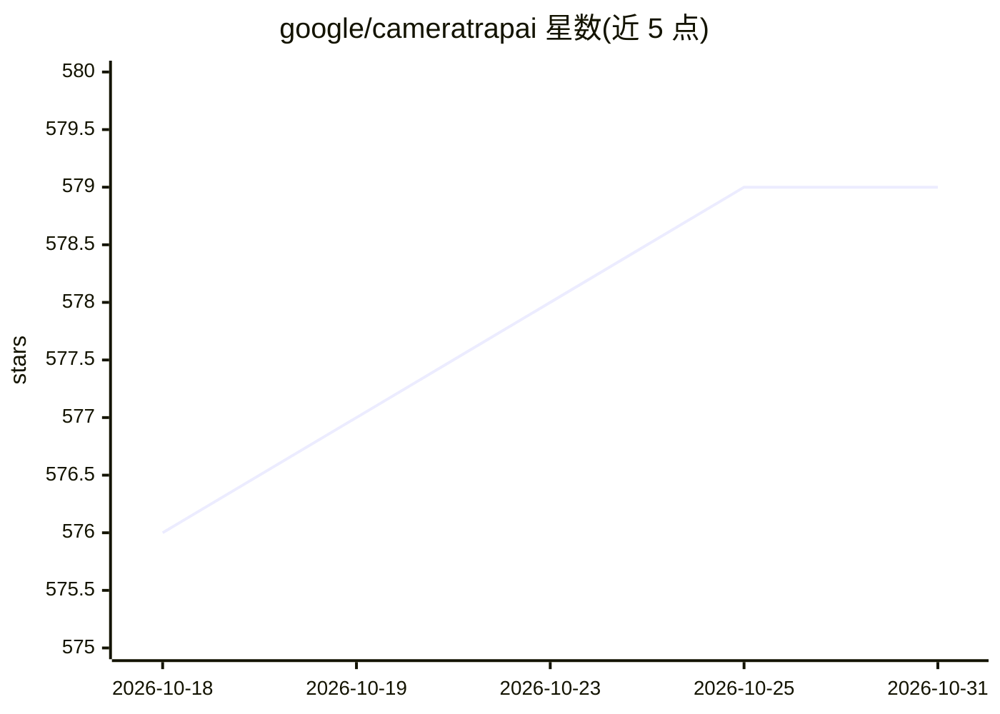

# google/cameratrapai

⭐ 579 · Python · Apache-2.0 · 推送 2026-10-20 · [GitHub](https://github.com/google/cameratrapai) · 组织维护

**Google 训练的野生动物相机陷阱图像物种分类模型**

由 Google 训练的两级模型级联：MegaDetector 检测器定位图像中的动物、人与车辆，SpeciesNet 分类器（EfficientNet V2 M 架构，训练数据超 6500 万张图像）将目标分类到 2000+ 标签（物种、高级分类单元与非动物类别）。提供 Python 包安装，支持按国家/地区代码做地理过滤，输出 JSON 预测结果并可转换为 MegaDetector 格式供 Timelapse 等工具使用。无 NVIDIA GPU 时也可在 CPU 上运行。

## 筛选速览

| 维度 | 判定 | 备注 |
|---|---|---|
| AI 角色 | `ai-native` | 本体是模型或模型工具 |
| 许可风险 | `permissive` | Apache-2.0 |
| 部署形态 | `library` | 以包/库形式分发 |
| 模型依赖 | — | README 未给出锁定关系 |
| 硬件要求 | — | 无带数字的原话,不猜 |
| 安装摩擦 | `medium` | 含编译或系统依赖之一 |
| 成熟度 | — | 结构信号不足 |

## 能力要点

- 检测器+分类器级联，覆盖 2000+ 物种与分类标签
- 基于超 6500 万张地理多样图像训练
- 支持 ISO 国家代码地理过滤（geofencing）与分类学汇总
- 支持 NVIDIA GPU（CUDA）加速与 CPU 回退

## 适用场景

- 批量处理相机陷阱图像并输出物种识别结果
- 保护从业者加速野生动物监测图像的分类整理
- 配合 Timelapse 等图像审查工具使用识别输出

## 场景标签

`目标检测` · 领域:感知与多模态

## 证据(README 行号)

> L11: This repository hosts code for running a cascade of two AI models: (1) an object detector that finds objects of int
> L15: The species classifier (SpeciesNet) was trained at Google using a large dataset of camera trap images and an Effici

## 星数曲线

2026-10-18 576 → 2026-10-31 579（+3）

---
*卡片 v1 · prompt 1.4 · 生成 2026-10-21 · 置信度 high · 依据 README sha `a18eaaa4db4d` · [字段定义](../../DATASET.md)*
