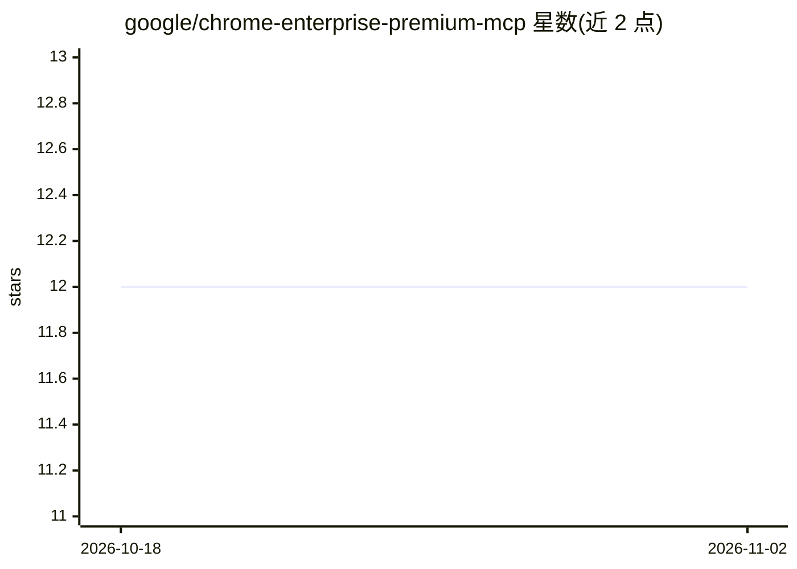

# google/chrome-enterprise-premium-mcp

⭐ 12 · JavaScript · Apache-2.0 · 推送 2026-09-08 · [GitHub](https://github.com/google/chrome-enterprise-premium-mcp) · [官网](https://chromeenterprise.google/) · 组织维护

**Chrome Enterprise Premium 的 MCP 服务器：让 AI agent 管理浏览器安全**

Google 提供的参考实现，将 Chrome Enterprise Premium (CEP) 的 DLP 规则、内容检测器、连接器策略、浏览器遥测与许可证管理封装为 MCP 工具，供任意 MCP 兼容客户端（Gemini CLI、Claude Desktop、Cursor 等）以自然语言检查和配置企业 Chrome 环境。提供发现、许可、DLP 增删、连接器、扩展、安全日志与内置知识库工具，经 OAuth 认证 Workspace 管理员账户。README 包含提示注入风险与管理员级权限的警告；Apache 2.0 许可，声明非官方支持产品。

## 筛选速览

| 维度 | 判定 | 备注 |
|---|---|---|
| AI 角色 | `ai-ecosystem` | LLM/agent 周边工具 |
| 许可风险 | `permissive` | Apache-2.0 |
| 部署形态 | `library` | 以包/库形式分发 |
| 模型依赖 | — | README 未给出锁定关系 |
| 硬件要求 | — | 无带数字的原话,不猜 |
| 安装摩擦 | `low` | 无编译、无系统依赖或容器化 |
| 成熟度 | — | 结构信号不足 |

## 能力要点

- 将 CEP 的 DLP/连接器/遥测/许可证管理暴露为 MCP 工具与 prompts
- stdio 传输，可经 Gemini CLI 一条命令安装或配置到其他 MCP 客户端
- 支持托管 OAuth、自定义 OAuth 客户端与无头/SSH 认证路径
- 提供健康检查、规则优化建议等内置 prompts 与内置知识库检索

## 适用场景

- 让 AI agent 检查并配置企业 Chrome 的 DLP 规则与内容检测器
- 通过对话查询 CEP 许可证状态与浏览器遥测数据
- 排查 Chrome Enterprise 环境的 API、连接器与扩展配置

## 场景标签

`网络安全` · 领域:学习与行业

## 证据(README 行号)

> L3: A Model Context Protocol (MCP) server for
> L9: so any MCP-compatible AI agent can inspect and configure a Chrome Enterprise

## 星数曲线

2026-10-18 12 → 2026-11-02 12（+0）

---
*卡片 v1 · prompt 1.4 · 生成 2026-11-01 · 置信度 high · 依据 README sha `eb7f04dddc6d` · [字段定义](../../DATASET.md)*
