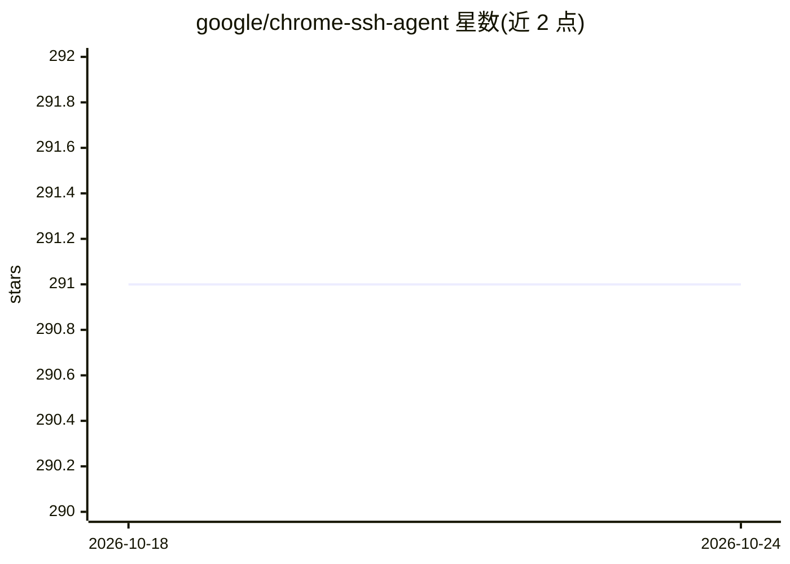

# google/chrome-ssh-agent

⭐ 291 · Go · Apache-2.0 · 推送 2026-02-19 · [GitHub](https://github.com/google/chrome-ssh-agent) · 组织维护

**Chrome Secure Shell 扩展可用的 SSH Agent 扩展**

面向使用 Secure Shell Chrome 扩展的用户的 SSH agent 实现，以 Chrome 扩展形式从 Web Store 安装。用户录入 PEM 编码的私钥并可选通过 Chrome Sync 在设备间同步（仅同步原始 PEM 内容，加密与否保持原状）；加载密钥时输入口令短语，随后在 Secure Shell 扩展的连接选项中指定该 agent 提供密钥。代码基于 GopherJS 复用 Go 的 SSH Agent 实现，非 Google 官方支持产品。

## 筛选速览

| 维度 | 判定 | 备注 |
|---|---|---|
| AI 角色 | `ai-ecosystem` | LLM/agent 周边工具 |
| 许可风险 | `permissive` | Apache-2.0 |
| 部署形态 | `None` |  |
| 模型依赖 | — | README 未给出锁定关系 |
| 硬件要求 | — | 无带数字的原话,不猜 |
| 安装摩擦 | `low` | 无编译、无系统依赖或容器化 |
| 成熟度 | — | 结构信号不足 |

## 能力要点

- 以 Chrome 扩展形式提供 SSH agent 实现
- 支持录入 PEM 私钥与口令短语加载
- 可通过 Chrome Sync 跨设备同步已配置密钥
- 基于 GopherJS 复用 Go 的 SSH Agent 实现

## 适用场景

- 在 Chrome Secure Shell 扩展中管理 SSH 私钥
- 通过 Chrome Sync 在多设备间使用同一组 SSH 密钥

## 场景标签

 · 领域:开发者工具/网络安全

## 证据(README 行号)

> L5: This is a bare-bones SSH agent extension for Google Chrome™. It provides an
> L6: SSH agent implementation that can be used with the
> L7: Secure Shell Chrome extension.

## 星数曲线

2026-10-18 291 → 2026-10-24 291（+0）

---
*卡片 v1 · prompt 1.4 · 生成 2026-10-22 · 置信度 high · 依据 README sha `e73b0f017293` · [字段定义](../../DATASET.md)*
