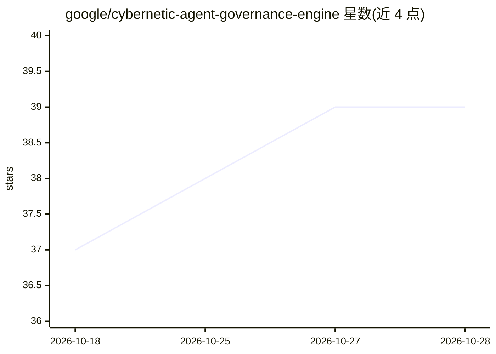

# google/cybernetic-agent-governance-engine

⭐ 42 · Python · Apache-2.0 · 推送 2026-10-28 · [GitHub](https://github.com/google/cybernetic-agent-governance-engine) · 组织维护

**域无关的 AI agent 运行时治理与对齐评测引擎**

CAGE 是一个不含内置应用的控制中间件与治理基底：在线侧通过控制屏障函数、共识仲裁、因果推理与 FTRA 可达性分析对生产工具调用做不可绕过的管道治理，附带加密证据封存与 Human-in-the-Loop 升级；离线侧以同一套屏障充当过程奖励预言机（PRM），生成反事实 DPO/RLVR 偏好对，并含 GEPA 反思优化与技能认证评测框架（src/eval_harness/）。支持通过 cage.plugins 入口点扩展金融、医疗等域插件，仓库内的金融顾问与医疗 agent 仅为参考应用。面向需要 agent 安全治理与对齐评测的开发者；部署依赖 GKE+Linkerd mTLS 等基础设施组件。

## 筛选速览

| 维度 | 判定 | 备注 |
|---|---|---|
| AI 角色 | `ai-ecosystem` | LLM/agent 周边工具 |
| 许可风险 | `permissive` | Apache-2.0 |
| 部署形态 | `self-host` | docker 或自建部署 |
| 模型依赖 | — | README 未给出锁定关系 |
| 硬件要求 | — | 无带数字的原话,不猜 |
| 安装摩擦 | `low` | 无编译、无系统依赖或容器化 |
| 成熟度 | — | 结构信号不足 |

## 能力要点

- 运行时治理与离线对齐共用同一套形式化屏障（Dual-Lifecycle Flywheel）
- 确定性过程奖励预言机与反事实 DPO 偏好对生成
- 通过 cage.plugins 入口点加载域插件，金融/医疗仅为示例
- 离线评测框架含 GEPA 反思优化、技能认证与多 rollout 适配器

## 适用场景

- 为生产环境 agent 的工具调用施加不可绕过的安全治理管道
- 离线批量评测 agent 轨迹并合成 DPO/RLVR 偏好对数据
- 按 US Federal/EU/APAC 等辖区配置合规姿态

## 场景标签

`模型评测` `强化学习` `网络安全` · 领域:评测与运维

## 证据(README 行号)

> L5: CAGE is an application-agnostic governance and alignment substrate that contains **zero built-in applications**. It 
> L8: - **Dual-Lifecycle Flywheel (Runtime $\leftrightarrow$ Alignment)** — The identical formal barriers execute online t
> L68: CAGE enforces a strict **Split-Plane Architecture** between **Online Runtime Enforcement** (`src/gateway/`, $<10\te

## 星数曲线

2026-10-18 37 → 2026-10-28 39（+2）

---
*卡片 v1 · prompt 1.4 · 生成 2026-10-25 · 置信度 high · 依据 README sha `d6ff21c3a213` · [字段定义](../../DATASET.md)*
