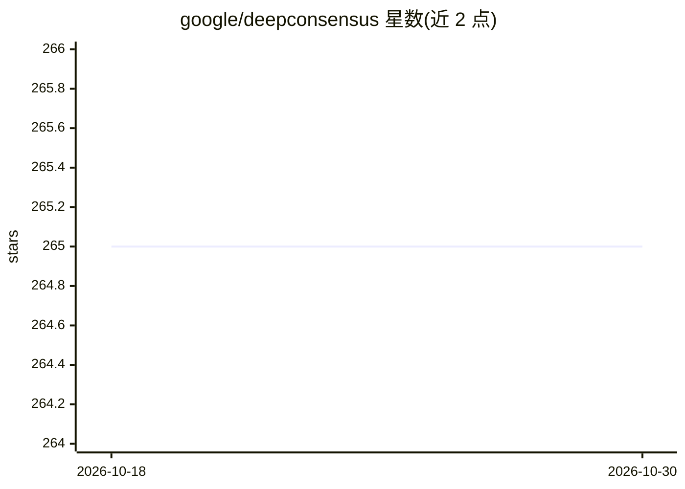

# google/deepconsensus

⭐ 265 · Python · BSD-3-Clause · 推送 2026-04-07 · [GitHub](https://github.com/google/deepconsensus) · 组织维护

**用 gap-aware transformer 纠正 PacBio CCS 测序错误的工具**

针对 Pacific Biosciences Circular Consensus Sequencing (CCS) 数据的纠错工具：使用 gap-aware sequence transformer 对 subreads 处理，生成 FASTQ 格式的纠正 reads，替代 CCS/HiFi reads 用于下游分析，可提升高质量 reads 产出。推荐将每个 SMRT Cell 切分为至少 500 个分片、每片在 16 CPU 机器上运行。提供 pip 包（GPU/CPU 两种）、Docker 镜像与源码安装三种途径；代码声明不用于临床。

## 筛选速览

| 维度 | 判定 | 备注 |
|---|---|---|
| AI 角色 | `ai-native` | 本体是模型或模型工具 |
| 许可风险 | `permissive` | BSD-3-Clause |
| 部署形态 | `self-host` | docker 或自建部署 |
| 模型依赖 | — | README 未给出锁定关系 |
| 硬件要求 | — | 无带数字的原话,不猜 |
| 安装摩擦 | `low` | 无编译、无系统依赖或容器化 |
| 成熟度 | — | 结构信号不足 |

## 能力要点

- gap-aware sequence transformer 纠正 PacBio CCS 错误
- 输出 FASTQ 纠正 reads 可替代 CCS/HiFi 用于下游变异检测与组装
- 支持 GPU/CPU 的 pip、Docker 与源码安装
- 提供分片并行运行的计算方案建议

## 适用场景

- PacBio 测序数据生成后对 subreads 做纠错再下游分析
- 提升下游组装与变异检测的序列质量
- 在 GPU 或 CPU 集群上分片并行处理 SMRT Cell 数据

## 场景标签

 · 领域:生物信息学/基因组学

## 证据(README 行号)

> L3: DeepConsensus uses gap-aware sequence transformers to correct errors in Pacific
> L4: Biosciences (PacBio) Circular Consensus Sequencing (CCS) data.
> L34: After a PacBio sequencing run, DeepConsensus is meant to be run on the subreads
> L35: to create new corrected reads in FASTQ format that can take the place of the

## 星数曲线

2026-10-18 265 → 2026-10-30 265（+0）

---
*卡片 v1 · prompt 1.4 · 生成 2026-10-22 · 置信度 high · 依据 README sha `17b40afab381` · [字段定义](../../DATASET.md)*
