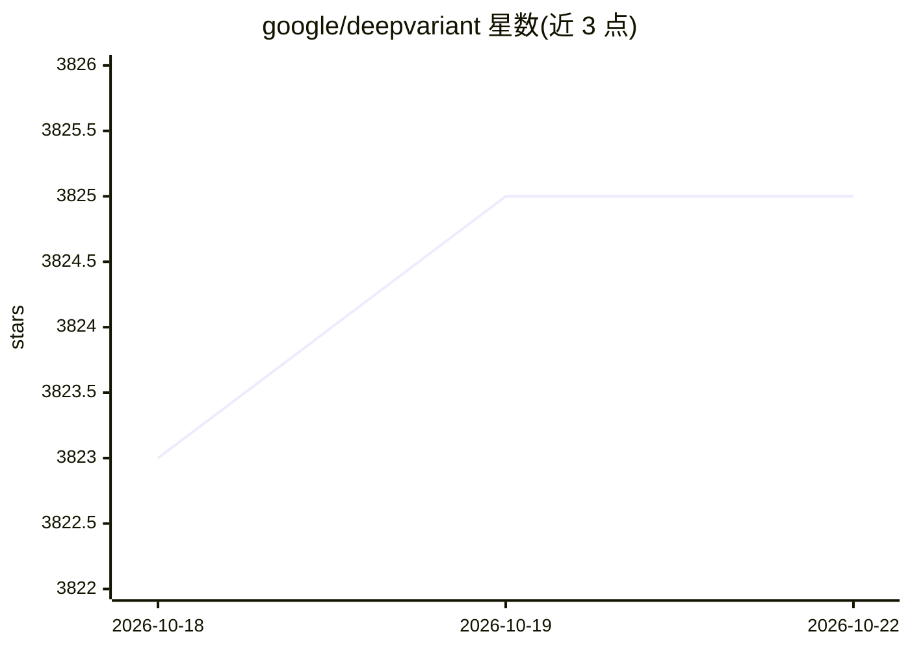

# google/deepvariant

⭐ 3,824 · Python · BSD-3-Clause · 推送 2026-09-30 · [GitHub](https://github.com/google/deepvariant) · 组织维护

**深度学习基因变异检测器：从测序比对数据产出 VCF 变异结果**

DeepVariant 是 Google 的深度学习变异检测流程：读取 BAM/CRAM 格式的比对读段，生成 pileup 图像张量，用卷积神经网络分类后输出标准 VCF/gVCF。支持二倍体生物的胚系变异检测，覆盖 Illumina、PacBio HiFi、ONT、Complete Genomics 等多种测序平台及 RNA 数据；附带 DeepTrio 三人组检测。附带模型仅在人类数据上训练，非临床用途。推荐 Docker 方式运行，也提供源码构建与预编译二进制，支持 CPU/GPU/TPU。

## 筛选速览

| 维度 | 判定 | 备注 |
|---|---|---|
| AI 角色 | `ai-native` | 本体是模型或模型工具 |
| 许可风险 | `permissive` | BSD-3-Clause |
| 部署形态 | `self-host` | docker 或自建部署 |
| 模型依赖 | — | README 未给出锁定关系 |
| 硬件要求 | — | 无带数字的原话,不猜 |
| 安装摩擦 | `low` | 无编译、无系统依赖或容器化 |
| 成熟度 | — | 结构信号不足 |

## 能力要点

- pileup 图像张量化 + CNN 分类的变异检测流程
- 支持 Illumina/PacBio HiFi/ONT R10.4.1 等多测序平台与泛基因组建模
- DeepTrio 扩展支持三人组/二人组变异检测
- Docker、源码构建、预编译二进制三种运行方式，支持 GPU/TPU 加速

## 适用场景

- 对全基因组/全外显子测序数据做胚系变异检测
- 处理 PacBio HiFi 或 Oxford Nanopore 长读长数据的变异 calling
- 家系样本（trio/duo）的联合变异检测

## 场景标签

 · 领域:生物信息学/基因组学

## 证据(README 行号)

> L5: DeepVariant is a deep learning-based variant caller that takes aligned reads (in
> L6: BAM or CRAM format), produces pileup image tensors from them, classifies each
> L7: tensor using a convolutional neural network, and finally reports the results in

## 星数曲线

2026-10-18 3,823 → 2026-10-22 3,825（+2）

---
*卡片 v1 · prompt 1.4 · 生成 2026-10-20 · 置信度 high · 依据 README sha `89180a180b52` · [字段定义](../../DATASET.md)*
