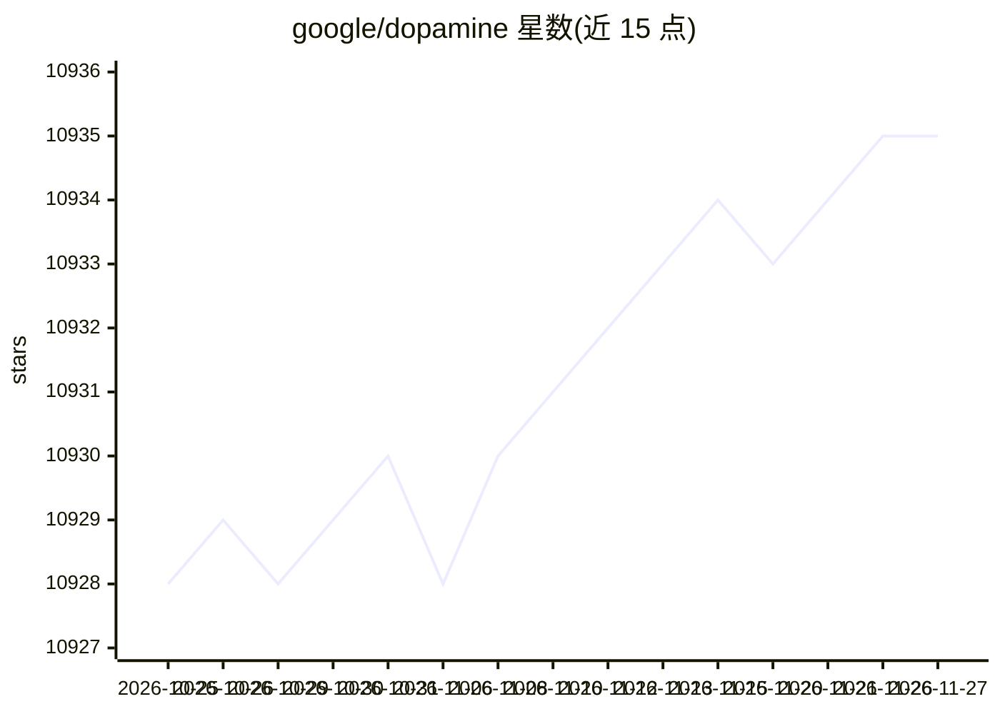

# google/dopamine

⭐ 10,935 · Jupyter Notebook · Apache-2.0 · 推送 2026-11-12 · [GitHub](https://github.com/google/dopamine) · [官网](https://github.com/google/dopamine) · 组织维护

**强化学习算法研究框架：快速原型实验**

面向强化学习算法研究的轻量框架，目标是提供易读、可自由改动的小型代码库，便于研究者验证新想法。设计原则包括易实验、灵活开发、紧凑可靠与可复现（遵循 Machado et al. 2018 的评估协议建议）。基于 jax 实现 DQN、C51、Rainbow、IQN、SAC、PPO 等智能体，部分保留 tensorflow 旧版实现；支持 Atari 与 Mujoco 环境。提供 docker 容器、源码安装与 pip 安装三种方式，附基线结果与 Colaboratory 笔记本示例。README 声明当前处于尽力维护模式，且非 Google 官方产品。

## 筛选速览

| 维度 | 判定 | 备注 |
|---|---|---|
| AI 角色 | `ai-native` | 本体是模型或模型工具 |
| 许可风险 | `permissive` | Apache-2.0 |
| 部署形态 | `library` | 以包/库形式分发 |
| 模型依赖 | — | README 未给出锁定关系 |
| 硬件要求 | — | 无带数字的原话,不猜 |
| 安装摩擦 | `low` | 无编译、无系统依赖或容器化 |
| 成熟度 | — | 结构信号不足 |

## 能力要点

- 基于 jax 实现 DQN、C51、Rainbow、IQN、SAC、PPO 智能体
- 支持 Atari 与 Mujoco 基准环境
- 提供 docker 容器、源码与 pip 三种安装途径
- 提供各智能体的基线结果与 Colab 示例笔记本

## 适用场景

- 快速实验新的强化学习算法想法
- 复现 DQN/Rainbow 等智能体在 Atari/Mujoco 上的基准结果
- 作为可修改的小型代码库开展教学与研究

## 场景标签

`强化学习` · 领域:训练与推理

## 证据(README 行号)

> L11: Dopamine is a research framework for fast prototyping of reinforcement learning
> L26: Dopamine supports the following agents, implemented with jax:
> L52: Dopamine supports Atari environments and Mujoco environments. Install the

## 星数曲线

2026-10-25 10,928 → 2026-11-27 10,935（+7）

---
*卡片 v1 · prompt 1.4 · 生成 2026-11-22 · 置信度 high · 依据 README sha `4aae8f495bcd` · [字段定义](../../DATASET.md)*
