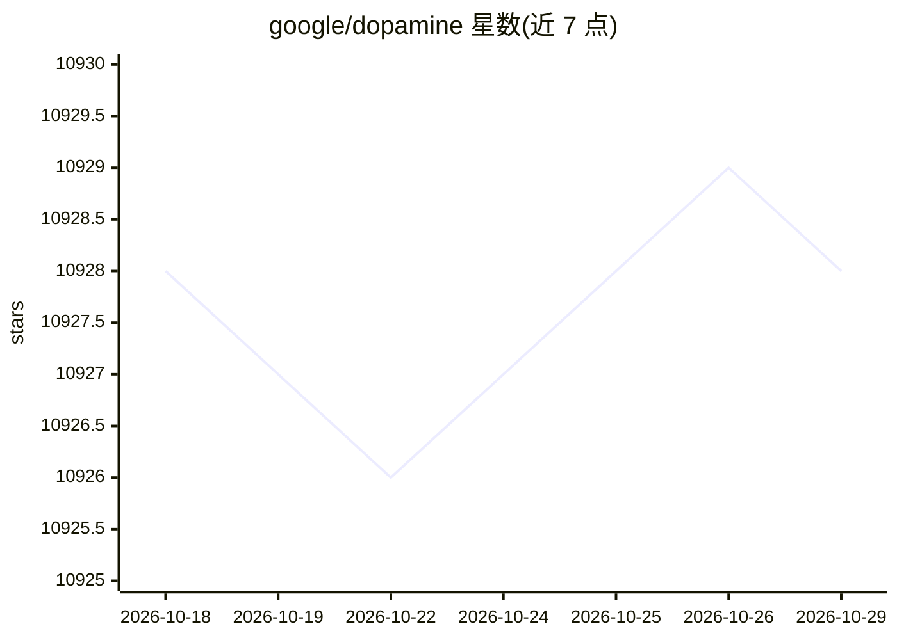

# google/dopamine

⭐ 10,928 · Jupyter Notebook · Apache-2.0 · 推送 2026-03-24 · [GitHub](https://github.com/google/dopamine) · [官网](https://github.com/google/dopamine) · 组织维护

**给强化学习研究者的快速原型实验框架**

Google 发布（非官方产品）的强化学习研究框架，定位为小巧、可读性高的代码库，便于研究者快速试验新想法并复现基准结果。以 jax 实现并提供 tensorflow 旧版实现，包含 DQN、C51、Rainbow、IQN、SAC、PPO 等算法，支持 Atari 与 Mujoco 环境。提供 docker 容器、pip 安装与源码安装三种方式，推荐源码安装以便直接修改；附有各 agent 的基准结果与 Colaboratory 示例笔记本。

## 筛选速览

| 维度 | 判定 | 备注 |
|---|---|---|
| AI 角色 | `ai-native` | 本体是模型或模型工具 |
| 许可风险 | `permissive` | Apache-2.0 |
| 部署形态 | `library` | 以包/库形式分发 |
| 模型依赖 | — | README 未给出锁定关系 |
| 硬件要求 | — | 无带数字的原话,不猜 |
| 安装摩擦 | `low` | 无编译、无系统依赖或容器化 |
| 成熟度 | — | 结构信号不足 |

## 能力要点

- jax 实现的 DQN/C51/Rainbow/IQN/SAC/PPO 等算法（部分含 tensorflow 旧版）
- 支持 Atari（ale_py）与 Mujoco 环境
- 为每个 agent 提供基准结果与示例笔记本
- 提供 docker 容器与 pip/源码两种安装途径

## 适用场景

- 快速原型验证强化学习新算法想法
- 复现或对比主流 RL 算法的基准结果
- 在 Atari/Mujoco 环境上训练与实验 agent

## 场景标签

`强化学习` · 领域:训练与推理

## 证据(README 行号)

> L7: Dopamine is a research framework for fast prototyping of reinforcement learning
> L22: Dopamine supports the following agents, implemented with jax:
> L33: Many of these agents also have a tensorflow (legacy) implementation, though

## 星数曲线

2026-10-18 10,928 → 2026-10-29 10,928（+0）

---
*卡片 v1 · prompt 1.4 · 生成 2026-10-20 · 置信度 high · 依据 README sha `1b6cb76e2404` · [字段定义](../../DATASET.md)*
