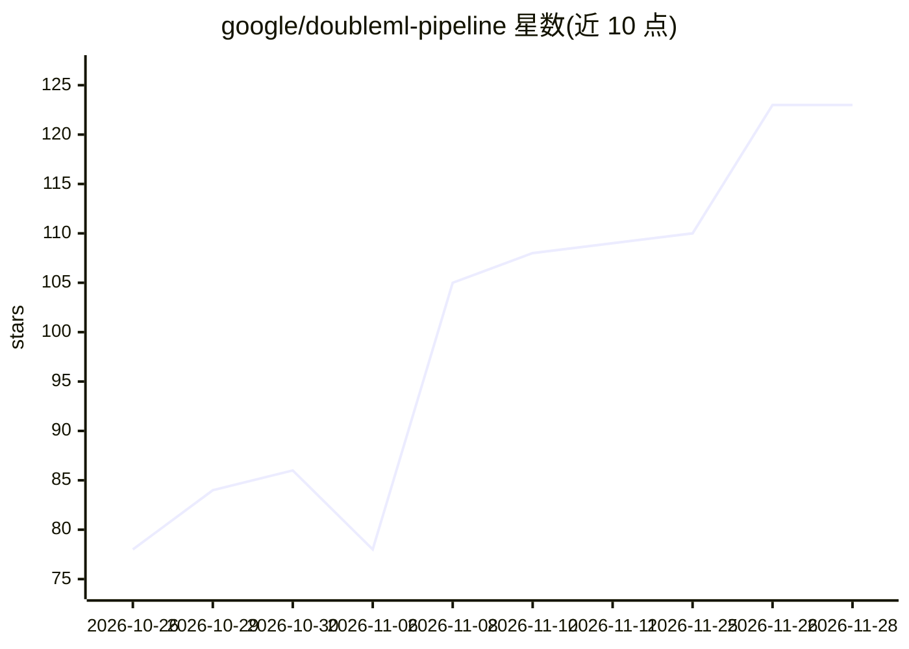

# google/doubleml-pipeline

⭐ 123 · Python · Apache-2.0 · 推送 2026-11-26 · [GitHub](https://github.com/google/doubleml-pipeline) · [官网](https://pypi.org/project/doubleml-pipeline/) · 组织维护

**营销分析者的因果推断自动化库：估计促销/定价/媒体的增量效果与 ROI**

基于 DoubleML 与 AutoML（FLAML）的因果推断流水线：输入 date × region × product 的面板数据，自动完成模型选择、超参调优、交叉拟合、重复估计、置信区间、敏感性分析与报告生成，输出增量 KPI、CATE、ROI 及自包含 HTML 报告。可选的 Saturation DML 阶段估计媒体花费的饱和响应曲线并做预算分配优化。由 Google APAP 营销效果团队构建，依赖 Python 3.10+，从 PyPI 安装。

## 筛选速览

| 维度 | 判定 | 备注 |
|---|---|---|
| AI 角色 | `ai-native` | 本体是模型或模型工具 |
| 许可风险 | `permissive` | Apache-2.0 |
| 部署形态 | `library` | 以包/库形式分发 |
| 模型依赖 | — | README 未给出锁定关系 |
| 硬件要求 | — | 无带数字的原话,不猜 |
| 安装摩擦 | `low` | 无编译、无系统依赖或容器化 |
| 成熟度 | — | 结构信号不足 |

## 能力要点

- run_full_pipeline 一次调用完成调参、交叉拟合、重复估计与 HTML 报告输出
- FLAML 自动选择 nuisance 模型，支持并行候选学习器网格搜索
- Saturation DML 可选阶段：饱和曲线估计与 KKT 预算分配优化
- Agentic AI 结果解读示例：Gemini agent 加载 causal-insights 技能读取运行结果

## 适用场景

- 估计上季度折扣带来的增量收入与 ROI
- 评估电视广告花费是否已饱和
- 找出促销在哪些地区、哪些时段效果最好
- 在区域和周期之间重新分配营销预算

## 场景标签

`数据分析` · 领域:效率与自动化

## 证据(README 行号)

> L12: (date × region × product). It uses Double Machine Learning (DML) to remove the
> L80: `run_full_pipeline` takes your data frame and your choice of Y / T / X and runs
> L112: ### Agentic AI utilization for insight generation

## 星数曲线

2026-10-26 78 → 2026-11-28 123（+45）

---
*卡片 v1 · prompt 1.4 · 生成 2026-11-28 · 置信度 mid · 依据 README sha `b71b353d93b5` · [字段定义](../../DATASET.md)*
