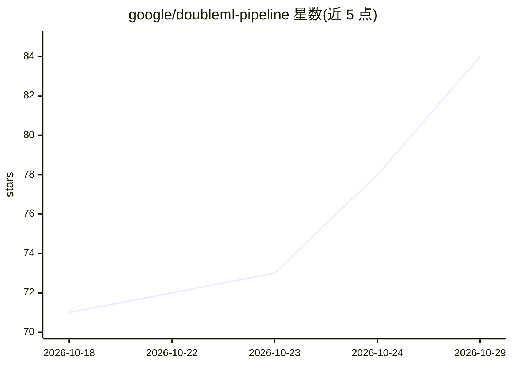

# google/doubleml-pipeline

⭐ 84 · Python · Apache-2.0 · 推送 2026-10-28 · [GitHub](https://github.com/google/doubleml-pipeline) · [官网](https://pypi.org/project/doubleml-pipeline/) · 组织维护

**自动 DoubleML+AutoML 因果推断库，估算营销增量与 ROI**

Google APAC 营销效果工作组维护的 Python 库，基于 DoubleML 与 FLAML AutoML 实现自动化因果推断：自动完成干扰参数建模（LightGBM/XGBoost 候选搜索）、业务单元安全缩放、CATE 异质性估计、遗漏变量偏误敏感性分析、贝叶斯 MMM 先验校准，并输出图表与 CSV。面向需要估算促销、定价与媒介干预增量影响及 ROI 的营销分析场景。要求 Python 3.10+，从 PyPI 安装。限制：优化仅支持单一 treatment，饱和优化仅限 spend 类型。

## 筛选速览

| 维度 | 判定 | 备注 |
|---|---|---|
| AI 角色 | `ai-native` | 本体是模型或模型工具 |
| 许可风险 | `permissive` | Apache-2.0 |
| 部署形态 | `library` | 以包/库形式分发 |
| 模型依赖 | — | README 未给出锁定关系 |
| 硬件要求 | — | 无带数字的原话,不猜 |
| 安装摩擦 | `low` | 无编译、无系统依赖或容器化 |
| 成熟度 | — | 结构信号不足 |

## 能力要点

- FLAML AutoML 自动搜索并调优干扰模型（LightGBM/XGBoost 等）
- CATE 异质性估计（连续样条/二值基）与 OVB 敏感性分析
- 输出 CATE、增量 KPI、ROI 及鲁棒性置信界（2.5%–97.5%）
- 提供营销模拟数据集与端到端示例 notebook

## 适用场景

- 估算促销或定价干预的真实增量影响与 ROI
- 检验因果估计对未观测混杂因素的敏感性
- 为贝叶斯 MMM 提取 DML 拟合分布作为先验

## 场景标签

`数据分析` · 领域:效率与自动化

## 证据(README 行号)

> L3: A robust Python library for automated causal inference utilizing Double Machine
> L17: With **DoubleML Pipeline**, you can estimate the true incremental impact and ROI
> L31: **DoubleML Pipeline** operationalizes this framework by combining DML with

## 星数曲线

2026-10-18 71 → 2026-10-29 84（+13）

---
*卡片 v1 · prompt 1.4 · 生成 2026-10-24 · 置信度 high · 依据 README sha `52d0bc711a75` · [字段定义](../../DATASET.md)*
