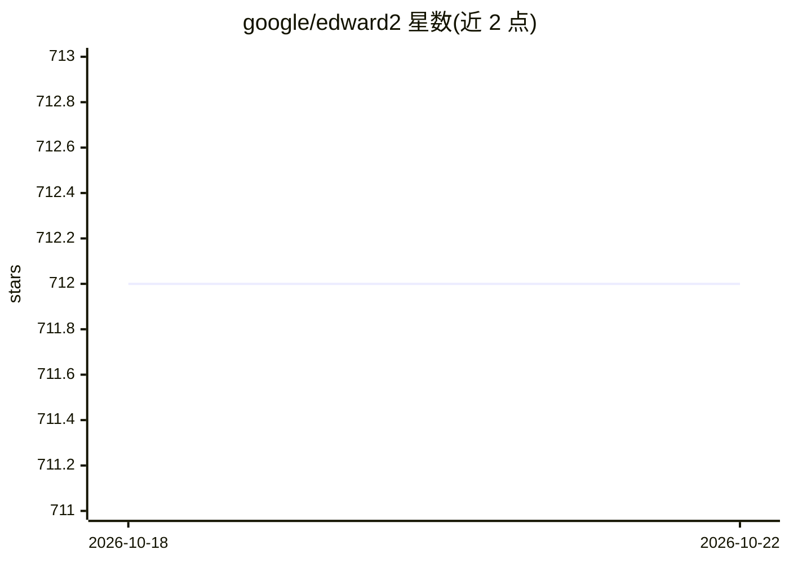

# google/edward2

⭐ 712 · Jupyter Notebook · Apache-2.0 · 推送 2026-10-05 · [GitHub](https://github.com/google/edward2) · 组织维护

**给研究者的轻量级概率编程语言，支持 TensorFlow/JAX/NumPy 后端**

Google 维护的 Python 概率编程库：用 RandomVariables 将概率模型写为 Python 生成函数，通过 tracing 与程序变换（如 make_log_joint）操控模型计算，实现灵活训练与推断（含贝叶斯逻辑回归、HMC 后验采样示例）。支持 TensorFlow（默认）、JAX、NumPy 三种后端，安装不自动附带后端需另行安装。README 自述核心工具较底层，推荐配合 Bayesian Layers 与 Uncertainty Baselines 使用；稳定版更新频率低。面向做贝叶斯深度学习与不确定性建模的开发者和研究人员。

## 筛选速览

| 维度 | 判定 | 备注 |
|---|---|---|
| AI 角色 | `ai-ecosystem` | LLM/agent 周边工具 |
| 许可风险 | `permissive` | Apache-2.0 |
| 部署形态 | `library` | 以包/库形式分发 |
| 模型依赖 | — | README 未给出锁定关系 |
| 硬件要求 | — | 无带数字的原话,不猜 |
| 安装摩擦 | `low` | 无编译、无系统依赖或容器化 |
| 成熟度 | — | 结构信号不足 |

## 能力要点

- 以 Python 函数书写概率模型，RandomVariables 携带分布并可参与张量运算
- tracing 与程序变换机制（如 make_log_joint 生成对数联合概率函数）支持灵活推断
- 支持 TensorFlow/JAX/NumPy 三种后端
- 附 NeurIPS 2018/2019 论文引用条目

## 适用场景

- 用概率程序构建贝叶斯神经网络并做不确定性建模
- 通过 HMC 等采样算法对模型后验进行推断
- 在 TensorFlow 或 JAX 生态中编写生成式概率模型

## 场景标签

 · 领域:机器学习/概率编程

## 证据(README 行号)

> L3: Edward2 is a _simple_ probabilistic programming language. It provides core
> L40: Edward2 supports three backends: TensorFlow (the default), JAX, and NumPy ([see

## 星数曲线

2026-10-18 712 → 2026-10-22 712（+0）

---
*卡片 v1 · prompt 1.4 · 生成 2026-10-21 · 置信度 high · 依据 README sha `0e6556a9143b` · [字段定义](../../DATASET.md)*
