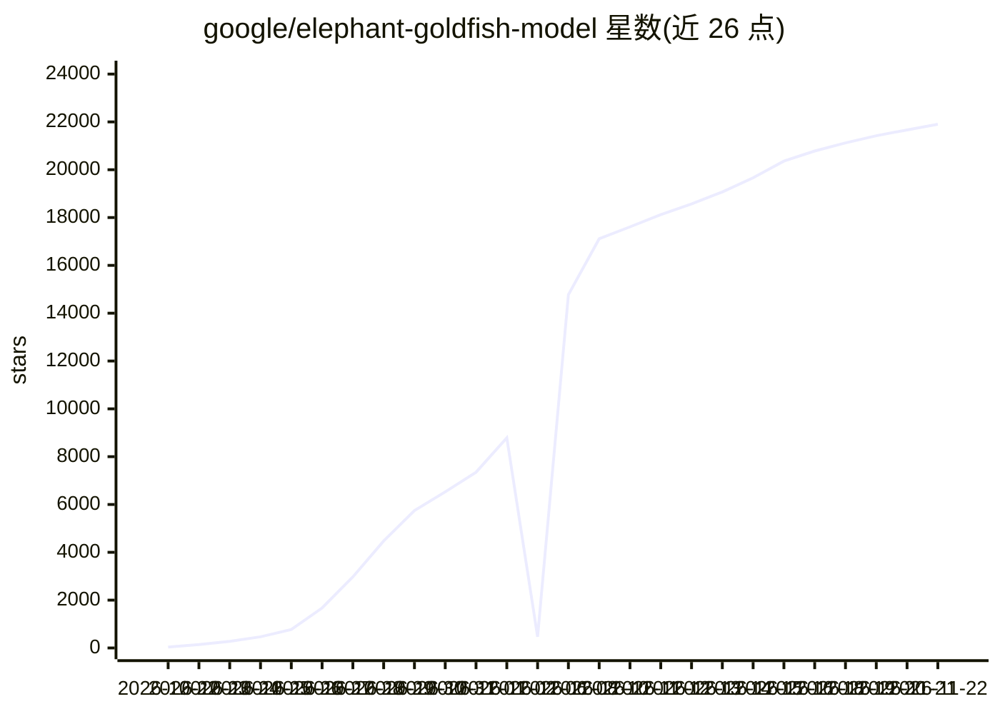

# google/elephant-goldfish-model

⭐ 21,901 · Python · Apache-2.0 · 推送 2026-11-21 · [GitHub](https://github.com/google/elephant-goldfish-model) · [官网](https://egm.dev) · 组织维护

**为 AI 编码助手提供设计起草与无上下文评审的插件**

面向 AI 编码助手的开源插件：Elephant 角色承载项目上下文并起草软件规格说明，Goldfish 评审角色在不携带先前会话的新子代理上下文中审查草稿与引用源码，用于暴露未言明的假设与盲点，用户负责权衡并批准规格。内置针对软件规格的起草与评审流程，提供 brainstorm、draft、review、bootstrap、drift report 等技能，可分别调用；要求宿主代理能创建全新子代理上下文，否则评审停止。通过各代理的插件市场或 CLI 命令安装，Apache 2.0 许可，非官方支持的 Google 产品。

## 筛选速览

| 维度 | 判定 | 备注 |
|---|---|---|
| AI 角色 | `ai-ecosystem` | LLM/agent 周边工具 |
| 许可风险 | `permissive` | Apache-2.0 |
| 部署形态 | `None` |  |
| 模型依赖 | locked-api |  |
| 硬件要求 | — | 无带数字的原话,不猜 |
| 安装摩擦 | `low` | 无编译、无系统依赖或容器化 |
| 成熟度 | — | 结构信号不足 |

## 能力要点

- Goldfish 评审者在全新子代理上下文中审查文档，不携带先前对话
- 提供 brainstorm/draft/review/bootstrap/drift report 等可单独调用的技能
- drift report 逐篇对比文档与当前源码并报告分歧
- 支持 Antigravity、Claude Code、Codex 等多种宿主代理安装

## 适用场景

- 在实现前由无上下文的评审者审查设计规格中的隐藏假设
- 对已有设计文档、README 或 PR 计划做代码一致性评审
- 批量检查文档与源码的漂移并决定更新哪一侧
- 为现有代码库生成或更新文档

## 场景标签

`代码审查` `代码生成` · 领域:编码与开发

## 证据(README 行号)

> L10: Develop ideas with context and review documents with fresh eyes. EGM is an open-source plugin for AI assistants.
> L12: **Elephant** holds your project context and drafts the specification. **Goldfish** reviewers examine the draft and 

## 星数曲线

2026-10-22 36 → 2026-11-22 21,901（+21,865）

---
*卡片 v1 · prompt 1.4 · 生成 2026-11-22 · 置信度 high · 依据 README sha `b69ad0ba7b02` · [字段定义](../../DATASET.md)*
