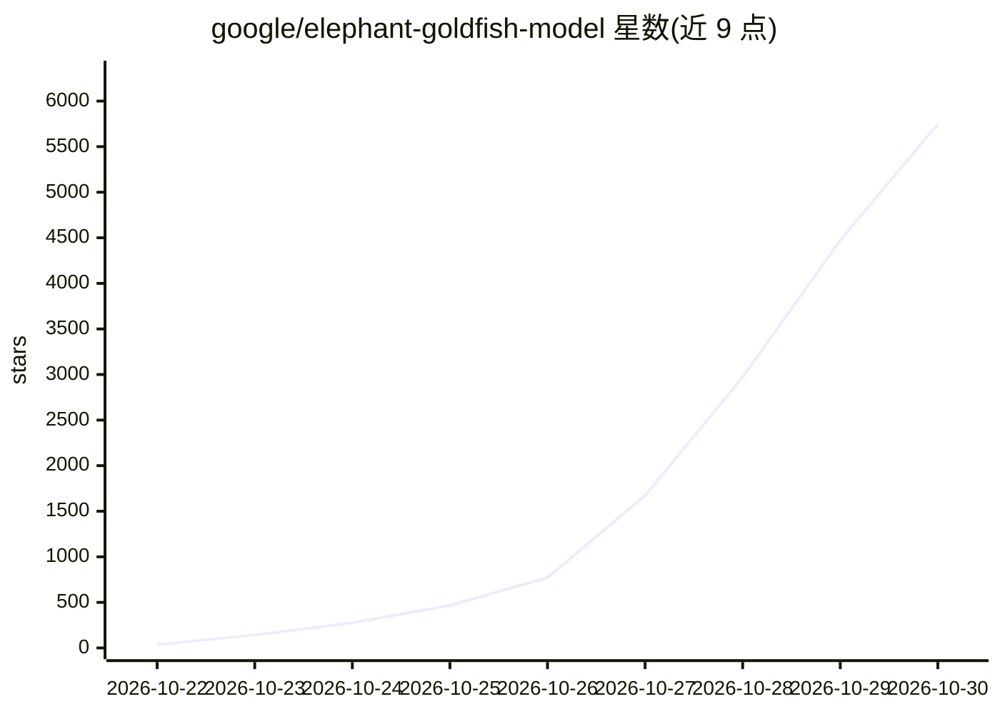

# google/elephant-goldfish-model

⭐ 5,748 · Python · Apache-2.0 · 推送 2026-10-29 · [GitHub](https://github.com/google/elephant-goldfish-model) · [官网](https://egm.dev) · 组织维护

**Google 出品的规格驱动开发框架：多智能体对抗评审设计规范**

面向自主 AI 编程智能体的规格驱动开发（SDD）框架与方法论：以富含上下文的系统描述为开发锚点，用两类智能体分工——深上下文的 Elephant 负责头脑风暴与起草规格，零上下文的无状态 Goldfish 智能体群从设计批评者、技术负责人、代码库审计等多个对立视角对设计做对抗式压力测试；人类工程师保留架构决策与最终结果所有权。提供 /egm-brainstorm、/egm-draft、/egm-review 等七个技能命令，支持 Antigravity 与 Gemini CLI 运行环境，工作流为构想→起草→评审与修复→提交 PR 后按规格实现。

## 筛选速览

| 维度 | 判定 | 备注 |
|---|---|---|
| AI 角色 | `ai-ecosystem` | LLM/agent 周边工具 |
| 许可风险 | `permissive` | Apache-2.0 |
| 部署形态 | `None` |  |
| 模型依赖 | — | README 未给出锁定关系 |
| 硬件要求 | — | 无带数字的原话,不猜 |
| 安装摩擦 | `low` | 无编译、无系统依赖或容器化 |
| 成熟度 | — | 结构信号不足 |

## 能力要点

- 七个技能命令覆盖头脑风暴、规格起草、多阶段评审、漂移检测等流程
- 无状态 Goldfish 智能体群做多视角对抗式设计压力测试
- AST 扫描检测已提交规格与实际代码之间的偏差
- 支持 Antigravity 与 Gemini CLI 两种运行环境

## 适用场景

- 在 AI 编程智能体开发流程中以设计规格为锚点管理复杂代码库
- 对技术设计文档做多智能体对抗式评审与自动修复
- 检测代码演进与规格文档的漂移

## 场景标签

`多智能体` · 领域:Agent 开发

## 证据(README 行号)

> L6: Elephant-Goldfish Model is an open-source framework and methodology for Spec-Driven Development (SDD) with autonomou
> L55: For detailed setup, supported harnesses (**Antigravity** and **Gemini CLI**), and walkthroughs, see Getting Started

## 星数曲线

2026-10-22 36 → 2026-10-30 5,748（+5,712）

---
*卡片 v1 · prompt 1.4 · 生成 2026-10-23 · 置信度 high · 依据 README sha `103774ac7560` · [字段定义](../../DATASET.md)*
