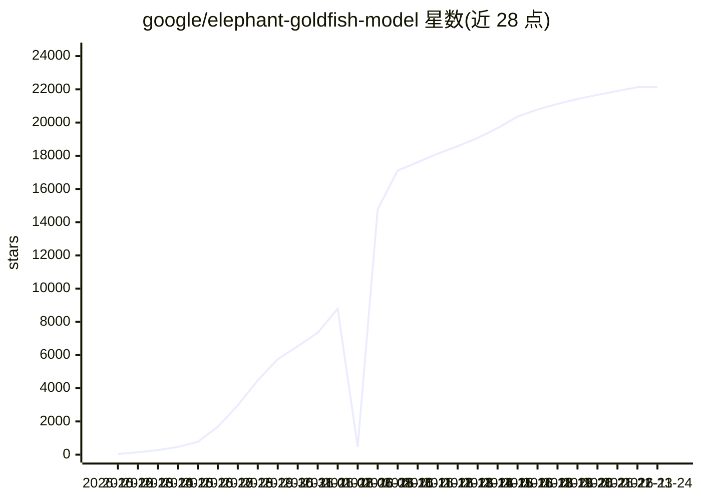

# google/elephant-goldfish-model

⭐ 22,437 · Python · Apache-2.0 · 推送 2026-11-23 · [GitHub](https://github.com/google/elephant-goldfish-model) · [官网](https://egm.dev) · 组织维护

**为 AI 编码代理提供设计起草与无上下文评审工作流的插件**

EGM 是面向 AI 编码助手的开源插件，内置'大象/金鱼'分工：Elephant 代理持有项目上下文并起草规格说明，Goldfish 评审代理在不读取先前对话的情况下独立检查草稿与引用的源码，用于暴露未言明的假设与盲点，由用户做架构取舍并批准规格。提供 brainstorm、draft、review、bootstrap、drift report 等独立技能命令。要求代理能创建全新 subagent 上下文，否则评审停止；评审不替代测试与人工判断。

## 筛选速览

| 维度 | 判定 | 备注 |
|---|---|---|
| AI 角色 | `ai-ecosystem` | LLM/agent 周边工具 |
| 许可风险 | `permissive` | Apache-2.0 |
| 部署形态 | `None` |  |
| 模型依赖 | — | README 未给出锁定关系 |
| 硬件要求 | — | 无带数字的原话,不猜 |
| 安装摩擦 | `low` | 无编译、无系统依赖或容器化 |
| 成熟度 | — | 结构信号不足 |

## 能力要点

- Elephant 起草 / Goldfish 无先前对话独立评审的双角色机制
- 七项可独立使用的技能：Brainstorm/Draft/Resolve/Bootstrap/Lite/Review/Review loop/Drift report
- 支持对既有设计文档、README 或 PR 计划与现行代码做漂移比对
- 支持 Antigravity CLI、Claude Code、Codex CLI 等多种代理安装

## 适用场景

- 为新功能设计规格并获得独立视角的多阶段评审
- 检查已入库设计文档与当前代码的偏差
- 为现有代码库生成或更新文档

## 场景标签

`多智能体` `编码 Agent` · 领域:Agent 开发

## 证据(README 行号)

> L10: Develop ideas with context and review documents with fresh eyes. EGM is an open-source plugin for AI assistants.
> L20: Choose your coding agent. Install the complete plugin so its skills can read the reviewer prompts and document stan
> L112: Goldfish reviews require fresh subagent contexts. If your agent cannot create them, EGM stops the review. A review

## 星数曲线

2026-10-22 36 → 2026-11-24 22,129（+22,093）

---
*卡片 v1 · prompt 1.4 · 生成 2026-11-24 · 置信度 high · 依据 README sha `bd57f91db434` · [字段定义](../../DATASET.md)*
