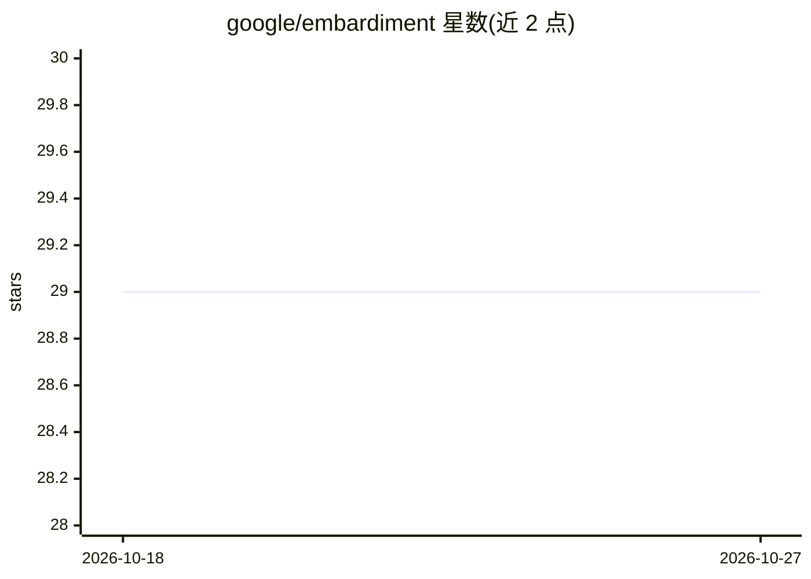

# google/embardiment

⭐ 29 · C# · Apache-2.0 · 推送 2026-05-01 · [GitHub](https://github.com/google/embardiment) · [官网](http://embardiment.github.io/) · 组织维护

**在 Unity/Android XR 中集成 ASR/LLM/OCR/TTS 的 AI agent 工具包**

Google 团队发布的 Unity Package（v1.0.0，需 Unity v6000.0+，Apache 2.0），为 Unity 项目添加 AI 功能并对 Android XR 设备提供原生兼容：ASR、LLM、OCR、TTS，其中 LLM/ASR/TTS 可通过 Gemini API（云端）或 Android 端侧（Gemini Nano 与原生能力）实现，OCR 支持端侧与桌面。面向科研团队与学生，可构建从纯端侧（无需 API key、隐私保留）到全云端的 agent。异步调用设计避免阻塞 Unity 主线程，回调参数保留上下文。是 IEEE VR'25 论文的工程实现，非官方支持的 Google 产品。

## 筛选速览

| 维度 | 判定 | 备注 |
|---|---|---|
| AI 角色 | `ai-ecosystem` | LLM/agent 周边工具 |
| 许可风险 | `permissive` | Apache-2.0 |
| 部署形态 | `None` |  |
| 模型依赖 | — | README 未给出锁定关系 |
| 硬件要求 | — | 无带数字的原话,不猜 |
| 安装摩擦 | `low` | 无编译、无系统依赖或容器化 |
| 成熟度 | — | 结构信号不足 |

## 能力要点

- ASR/LLM/OCR/TTS 四类能力，支持 Android XR 端侧与 Gemini API 云端
- 可构建无需 API key 的纯端侧 agent（基于 Gemini Nano 与原生 Android 能力）
- 异步服务调用设计（UnityEvent OnComplete 与回调参数）
- 提供 Android XR / Android Mobile / Desktop 三类示例工程模板

## 适用场景

- 科研团队在 XR 中搭建端侧或云端 AI agent 原型
- 课堂教学中让学生无需 API key 体验设备端 AI agent
- 在 Unity 项目里为 Android XR 添加语音识别与语音合成交互

## 场景标签

`科研工具` `Agent 框架` · 领域:Agent 开发

## 证据(README 行号)

> L9: Embardiment is a user-friendly Unity Package for adding AI functionality to Unity projects, with built native compat
> L11: It provides support the following features and following platforms:
> L20: These features allow for any research team to build from a full on-device to full on-cloud agents. The matrix of fe

## 星数曲线

2026-10-18 29 → 2026-10-27 29（+0）

---
*卡片 v1 · prompt 1.4 · 生成 2026-10-26 · 置信度 high · 依据 README sha `0a28976d3761` · [字段定义](../../DATASET.md)*
