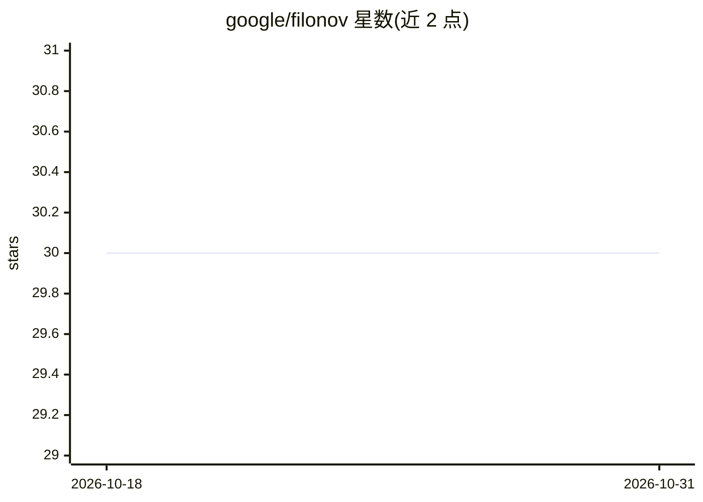

# google/filonov

⭐ 30 · Python · Apache-2.0 · 推送 2026-10-13 · [GitHub](https://github.com/google/filonov) · [官网](https://google.github.io/filonov/) · 组织维护

**创意素材相似性聚类分析工具：给广告/媒体团队找出素材共性**

由两部分组成：Data Pipeline 是一组命令行工具（入口 CLI 名为 filonov），读取图片/视频素材链接，用指定 tagger 基于相似性将素材聚类成资产图，并从 Google Ads API 与 YouTube API 附加表现指标，输出 JSON 图数据；Data Visualization 是部署在 Firebase 静态托管的 Serverless Web 应用（filonov-ai.web.app），无鉴权公开访问，用于打开 Pipeline 生成的数据文件。README 声明非 Google 官方支持产品，且未提供具体安装命令。

## 筛选速览

| 维度 | 判定 | 备注 |
|---|---|---|
| AI 角色 | `ai-native` | 本体是模型或模型工具 |
| 许可风险 | `permissive` | Apache-2.0 |
| 部署形态 | `None` |  |
| 模型依赖 | — | README 未给出锁定关系 |
| 硬件要求 | — | 无带数字的原话,不猜 |
| 安装摩擦 | `low` | 无编译、无系统依赖或容器化 |
| 成熟度 | — | 结构信号不足 |

## 能力要点

- CLI 工具 filonov 生成基于相似性聚类的素材图 JSON
- 素材节点附加来自 Google Ads API 与 YouTube API 的表现指标
- Serverless 可视化 Web 应用，公开可访问，支持本地或远程链接打开数据

## 适用场景

- 分析大量图片/视频创意之间的相似性
- 结合广告表现指标识别哪些创意方向更有效
- 在浏览器中可视化创意聚类图

## 场景标签

`图像视频处理` · 领域:感知与多模态

## 证据(README 行号)

> L12: my media (being image or videos). Simply links to your media, specify tagger
> L23: with graph of assets (images/video) grouped in clusters based on similarity. Additionally

## 星数曲线

2026-10-18 30 → 2026-10-31 30（+0）

---
*卡片 v1 · prompt 1.4 · 生成 2026-10-26 · 置信度 mid · 依据 README sha `720f1202efee` · [字段定义](../../DATASET.md)*
