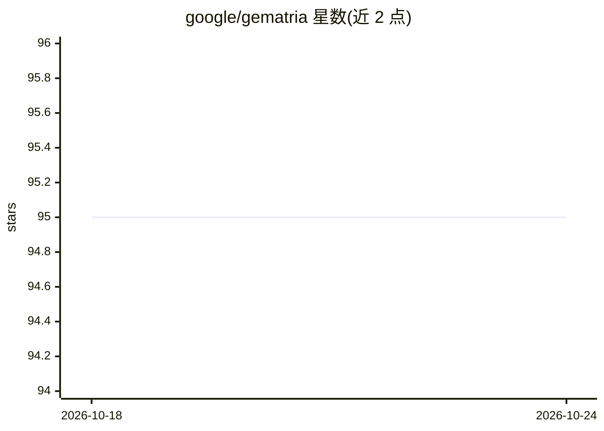

# google/gematria

⭐ 95 · Python · Apache-2.0 · 推送 2026-02-13 · [GitHub](https://github.com/google/gematria) · 组织维护

**面向机器码的机器学习框架：预测基本块反向吞吐量**

Google 开源的机器码机器学习框架，包含 GRANITE 图神经网络模型与 Ithemal 层级 LSTM 模型的实现，用于学习基本块的反向吞吐量。代码为 C++ 与 Python 混合，基于 TensorFlow 2.x（兼容层），通过 pybind11 暴露 C++ API，构建依赖 Bazel，部分工具链可通过 CMake 构建。在 Linux/x86-64 上开发测试，macOS 与 ARM 亦有测试。提供训练指南及 Python/C++ 推理指南，附 IISWC 2022 论文引用信息。

## 筛选速览

| 维度 | 判定 | 备注 |
|---|---|---|
| AI 角色 | `ai-native` | 本体是模型或模型工具 |
| 许可风险 | `permissive` | Apache-2.0 |
| 部署形态 | `None` |  |
| 模型依赖 | — | README 未给出锁定关系 |
| 硬件要求 | — | 无带数字的原话,不猜 |
| 安装摩擦 | `medium` | 含编译或系统依赖之一 |
| 成熟度 | — | 结构信号不足 |

## 能力要点

- 实现 GRANITE（图神经网络）与 Ithemal（层级 LSTM）两个吞吐量预测模型
- C++/Python 混合实现，基于 TensorFlow 2.x 与 pybind11
- 支持 Bazel 与 CMake 两种构建方式
- 在 Linux/x86-64 开发测试，macOS 与 ARM 亦有测试

## 适用场景

- 预测基本块反向吞吐量用于性能分析
- 训练/复现 GRANITE 或 Ithemal 模型
- 通过 Python 或 C++ 接口做推理

## 场景标签

`模型训练` `推理引擎` · 领域:训练与推理

## 证据(README 行号)

> L3: Contains sources of Gematria, a framework for machine learning on machine code.
> L6: Ithemal hierarchical LSTM model for learning
> L7: inverse throughput of basic blocks.

## 星数曲线

2026-10-18 95 → 2026-10-24 95（+0）

---
*卡片 v1 · prompt 1.4 · 生成 2026-10-23 · 置信度 high · 依据 README sha `72c96f4902b7` · [字段定义](../../DATASET.md)*
