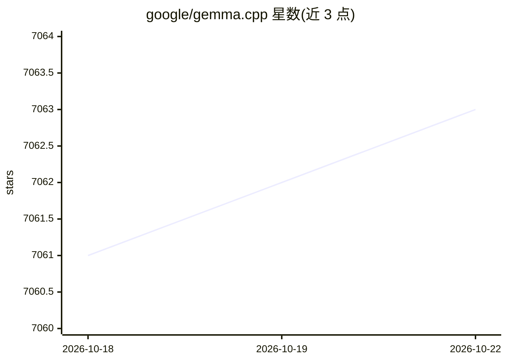

# google/gemma.cpp

⭐ 7,064 · C++ · Apache-2.0 · 推送 2026-10-22 · [GitHub](https://github.com/google/gemma.cpp) · 组织维护

**Gemma 模型的轻量独立 C++ 推理引擎，面向研究实验**

Google 维护的 Gemma-2/Gemma-3/PaliGemma-2 极简 C++ CPU 推理实现：核心约 2K 行代码，依赖少、便于嵌入和修改，定位实验与研究而非生产部署（生产建议走 JAX/PyTorch/Transformers）。使用 Highway 库实现跨平台 SIMD，支持 fp8/bf16/NUQ 混合精度 GEMM、运行时自动调优、张量并行与权重压缩格式；含 TopK/温度采样、反向传播与 Adam 优化器。通过 CMake/Bazel 从源码构建，模型权重需从 Kaggle 或 Hugging Face 获取。

## 筛选速览

| 维度 | 判定 | 备注 |
|---|---|---|
| AI 角色 | `ai-native` | 本体是模型或模型工具 |
| 许可风险 | `permissive` | Apache-2.0 |
| 部署形态 | `desktop` | 安装包/桌面程序 |
| 模型依赖 | — | README 未给出锁定关系 |
| 硬件要求 | `cpu-ok` | |
| 安装摩擦 | `medium` | 含编译或系统依赖之一 |
| 成熟度 | — | 结构信号不足 |

## 能力要点

- CPU-only 推理，支持 Gemma 2/3 与 PaliGemma 2 视觉语言模型
- 混合精度 GEMM（自定义 fp8、bf16、NUQ 4-bit）与运行时自动调优
- 含反向传播（VJP）与 Adam 优化器，面向研究
- 流式 C++ API、交互式 CLI 与 pybind11 Python 绑定

## 适用场景

- 在 CPU 上本地运行 Gemma 模型做文本生成或图像描述
- 研究/实验中修改推理算法与低层计算
- 以最小依赖将 Gemma 推理嵌入其他 C++ 项目

## 场景标签

`推理引擎` · 领域:训练与推理

## 证据(README 行号)

> L3: gemma.cpp is a lightweight, standalone C++ inference engine for the Gemma
> L45:  - CPU-only inference for: Gemma 2-3, PaliGemma 2.
> L28: gemma.cpp targets experimentation and research use cases. It is intended to be

## 星数曲线

2026-10-18 7,061 → 2026-10-22 7,063（+2）

---
*卡片 v1 · prompt 1.4 · 生成 2026-10-20 · 置信度 high · 依据 README sha `942c535d0676` · [字段定义](../../DATASET.md)*
