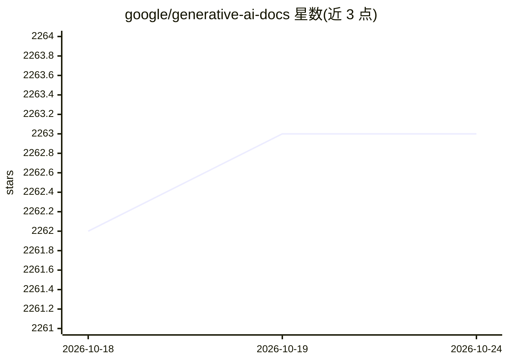

# google/generative-ai-docs

⭐ 2,263 · Jupyter Notebook · Apache-2.0 · 推送 2026-01-26 · [GitHub](https://github.com/google/generative-ai-docs) · [官网](https://ai.google.dev) · 组织维护

**Gemini API 官方文档与示例源码仓库（已弃用）**

存放 ai.google.dev 生成式 AI 开发者站点部分指南与教程的源文件，涵盖 Gemini API 与 Gemma。目录含 site/（站点直接使用的 notebook 与内容）、demos/（可运行的完整演示应用）、examples/（演示单一概念的小型示例代码）。仓库已声明弃用且不再维护，访问者被引导至 Gemini 官方文档、Gemini Cookbook 与 Gemma Cookbook 三个活跃资源。Apache 2.0 许可。

## 筛选速览

| 维度 | 判定 | 备注 |
|---|---|---|
| AI 角色 | `ai-knowledge` | 知识聚合/清单类 |
| 许可风险 | `permissive` | Apache-2.0 |
| 部署形态 | `None` |  |
| 模型依赖 | — | README 未给出锁定关系 |
| 硬件要求 | — | 无带数字的原话,不猜 |
| 安装摩擦 | `low` | 无编译、无系统依赖或容器化 |
| 成熟度 | — | 结构信号不足 |

## 能力要点

- site/ 目录存放 ai.google.dev 站点使用的 notebook 与内容
- demos/ 提供完整可运行的演示应用
- examples/ 含演示单一概念的小型示例代码
- 仓库已弃用，指引至官方文档与两个 Cookbook

## 适用场景

- 查阅 Gemini API 官方文档的早期源文件
- 参考 Gemini/Gemma 的官方示例与演示应用代码

## 场景标签

`教程课程` · 领域:学习与行业

## 证据(README 行号)

> L11: These are the source files for some guides and tutorials on
> L12: the Generative AI developer site, home to

## 星数曲线

2026-10-18 2,262 → 2026-10-24 2,263（+1）

---
*卡片 v1 · prompt 1.4 · 生成 2026-10-21 · 置信度 high · 依据 README sha `a270efd6cbea` · [字段定义](../../DATASET.md)*
