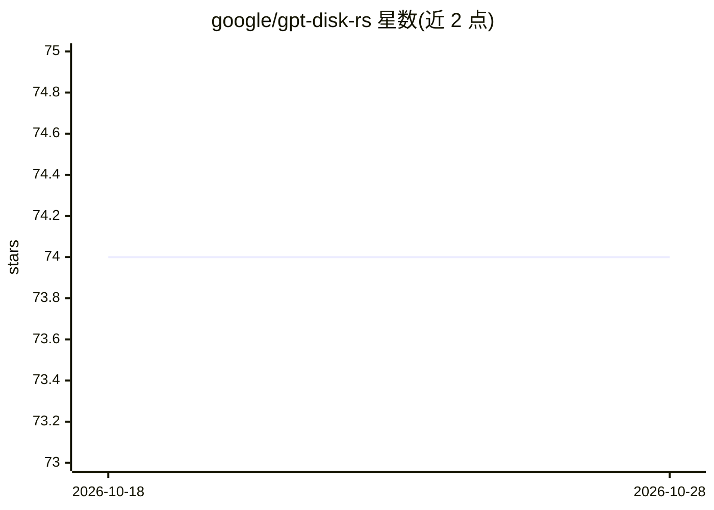

# google/gpt-disk-rs

⭐ 74 · Rust · Apache-2.0 · 推送 2026-10-20 · [GitHub](https://github.com/google/gpt-disk-rs) · 个人维护

**解析与读写 GPT（GUID 分区表）磁盘数据的 Rust no_std 库**

Google 名下个人维护性质仓库（非官方 Google 项目），包含三个 Rust 包：uguid 提供 UEFI 规范与 Windows 使用的 GUID 类型；gpt_disk_types 提供 GPT 头、分区数组、MBR 等类型的定义，保证字节序正确且可处理损坏输入；gpt_disk_types 之上的 gpt_disk_io 通过抽象的块级 IO 接口实现对任意后端的 GPT 数据读写。全部包支持 no_std，可在无标准库环境使用。面向系统编程与嵌入式/引导程序开发者。

## 筛选速览

| 维度 | 判定 | 备注 |
|---|---|---|
| AI 角色 | `ai-enhanced` | 去掉 AI 部分产品仍成立 |
| 许可风险 | `permissive` | Apache-2.0 |
| 部署形态 | `library` | 以包/库形式分发 |
| 模型依赖 | — | README 未给出锁定关系 |
| 硬件要求 | — | 无带数字的原话,不猜 |
| 安装摩擦 | `low` | 无编译、无系统依赖或容器化 |
| 成熟度 | — | 结构信号不足 |

## 能力要点

- 三个包：uguid / gpt_disk_types / gpt_disk_io
- no_std 支持，可用于嵌入式与引导环境
- 通过抽象 BlockIo 接口对接任意块级 IO 后端
- 类型设计保证字节序正确并容忍损坏输入

## 适用场景

- 在引导程序或嵌入式系统中解析 GPT 分区表
- 为任意块设备后端实现 GPT 数据的读写
- 在 Rust 项目中复用符合 UEFI 规范的 GUID 与 GPT 类型

## 场景标签

 · 领域:系统/存储软件库

## 证据(README 行号)

> L5: `no_std` libraries related to [GPT] (GUID Partition Table) disk
> L68: This project is not an official Google project. It is not supported by

## 星数曲线

2026-10-18 74 → 2026-10-28 74（+0）

---
*卡片 v1 · prompt 1.4 · 生成 2026-10-24 · 置信度 low · 依据 README sha `b0375e08b898` · [字段定义](../../DATASET.md)*
