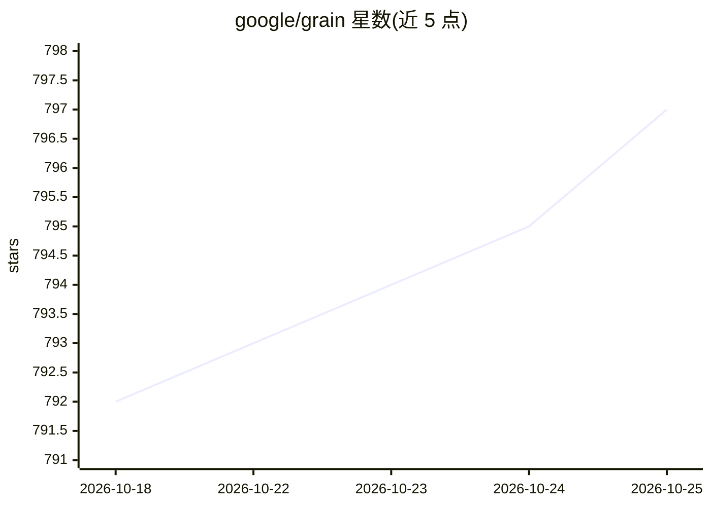

# google/grain

⭐ 797 · Python · Apache-2.0 · 推送 2026-10-23 · [GitHub](https://github.com/google/grain) · [官网](https://google-grain.readthedocs.io) · 组织维护

**面向 JAX 模型的确定性数据读取与处理 Python 库**

Grain 是用于训练与评估 JAX 模型的数据读取和处理 Python 库，以声明式方式定义数据处理步骤，强调灵活性、速度与确定性。为 JAX 设计但不依赖 JAX，可配合其他框架使用。变换默认在 CPU 上执行，不直接使用 GPU/TPU；支持 Linux（x86_64/aarch64）、Mac（aarch64）与 Windows（x86_64）。已发布于 PyPI，被 MaxText、Gemma 等项目使用。

## 筛选速览

| 维度 | 判定 | 备注 |
|---|---|---|
| AI 角色 | `ai-ecosystem` | LLM/agent 周边工具 |
| 许可风险 | `permissive` | Apache-2.0 |
| 部署形态 | `library` | 以包/库形式分发 |
| 模型依赖 | — | README 未给出锁定关系 |
| 硬件要求 | — | 无带数字的原话,不猜 |
| 安装摩擦 | `low` | 无编译、无系统依赖或容器化 |
| 成熟度 | — | 结构信号不足 |

## 能力要点

- 声明式定义数据处理步骤
- 设计面向 JAX 但不依赖 JAX，可配合其他框架
- 变换默认在 CPU 执行，不直接使用 GPU/TPU

## 适用场景

- 为 JAX 模型训练提供确定性数据管道
- 以声明式 API 组合数据读取与变换
- 在 Linux/Mac/Windows 上读取与处理训练数据

## 场景标签

`MLOps` · 领域:训练与推理

## 证据(README 行号)

> L11: Grain is a Python library for reading and processing data for training and
> L23: Grain is designed to work with JAX models but it does not require JAX to run

## 星数曲线

2026-10-18 792 → 2026-10-25 797（+5）

---
*卡片 v1 · prompt 1.4 · 生成 2026-10-21 · 置信度 high · 依据 README sha `8d81664cd6af` · [字段定义](../../DATASET.md)*
