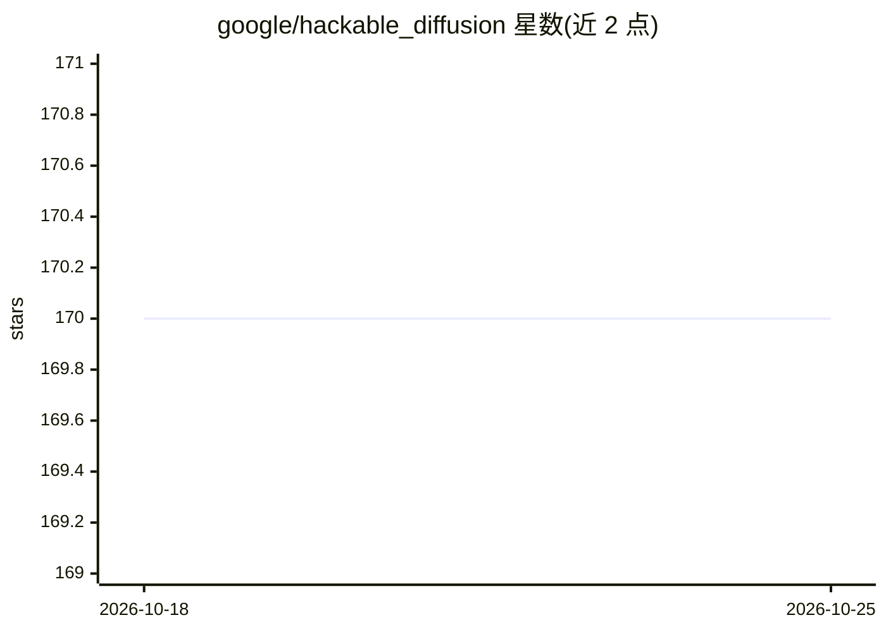

# google/hackable_diffusion

⭐ 170 · Jupyter Notebook · Apache-2.0 · 推送 2026-10-21 · [GitHub](https://github.com/google/hackable_diffusion) · 组织维护

**JAX 扩散模型实验与教学模块化工具箱**

Google 开发者维护的 JAX 扩散建模工具箱，面向扩散模型研究与教育场景。按架构、corruption、推理、损失、采样划分为独立子库，通过组合小型 Python 对象构建模型与训练循环；以 Nested 组件模式原生支持图像与文本的多模态扩散，并支持 Gemma 文本扩散微调（适配器位于 gemma 仓库）。提供 2D 玩具数据、MNIST 连续/离散/多模态等教程 notebook 与训练配置，需本地编写启动脚本运行。限制：非官方 Google 产品，安装方式为源码 pip install -e .。

## 筛选速览

| 维度 | 判定 | 备注 |
|---|---|---|
| AI 角色 | `ai-ecosystem` | LLM/agent 周边工具 |
| 许可风险 | `permissive` | Apache-2.0 |
| 部署形态 | `library` | 以包/库形式分发 |
| 模型依赖 | — | README 未给出锁定关系 |
| 硬件要求 | — | 无带数字的原话,不猜 |
| 安装摩擦 | `low` | 无编译、无系统依赖或容器化 |
| 成熟度 | — | 结构信号不足 |

## 能力要点

- 模块化子库划分（architecture/corruption/inference/loss/sampling）
- Nested 组件模式原生支持多模态（图像+文本）扩散
- Gemma 文本扩散微调集成（混合 AR-diffusion）
- 提供 2D/MNIST 系列教程 notebook 与训练配置

## 适用场景

- 研究者快速实验新的扩散建模想法
- 学习扩散模型的训练、离散扩散与多模态生成
- 复现和改造扩散训练配置做原型验证

## 场景标签

`图像生成` `教程课程` `多模态` · 领域:内容生成

## 证据(README 行号)

> L3: Hackable Diffusion is a modular toolbox written in Jax to experiment and educate
> L16: * **Composition over Configuration**: Build models and training loops by composing small, well-defined Python objec
> L17: * **Clear Separation of Concerns**: The codebase is organized into logical sub-libraries for architecture, corrupti

## 星数曲线

2026-10-18 170 → 2026-10-25 170（+0）

---
*卡片 v1 · prompt 1.4 · 生成 2026-10-22 · 置信度 high · 依据 README sha `663436aa0464` · [字段定义](../../DATASET.md)*
