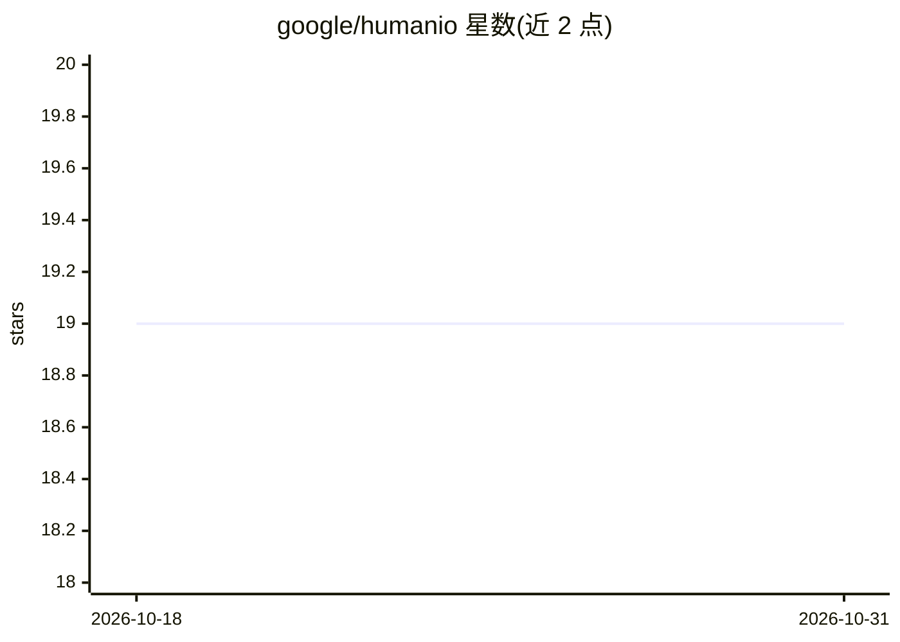

# google/humanio

⭐ 19 · JavaScript · Apache-2.0 · 推送 2026-07-24 · [GitHub](https://github.com/google/humanio) · 组织维护

**用 LLM 与第一人称视觉检测情境性障碍（SIIDs）的研究项目**

Google 研究团队发布的 CHI 2024 论文配套代码：通过预测人类输入/输出通道的可用性，统一检测各类情境诱发的障碍与失能（SIIDs），结合第一人称视觉、多模态传感与 LLM 推理。运行需设置 OPENAI_API_KEY（经服务器代理调用）并放置 Google Cloud Vision AI 凭据文件；以 npm 启动本地 Web 服务，支持浏览器摄像头或本地 mp4 视频输入。官方声明代码库不再积极维护，后续工作为 Sensible Agent 与 XR Blocks。

## 筛选速览

| 维度 | 判定 | 备注 |
|---|---|---|
| AI 角色 | `ai-native` | 本体是模型或模型工具 |
| 许可风险 | `permissive` | Apache-2.0 |
| 部署形态 | `library` | 以包/库形式分发 |
| 模型依赖 | — | README 未给出锁定关系 |
| 硬件要求 | — | 无带数字的原话,不猜 |
| 安装摩擦 | `low` | 无编译、无系统依赖或容器化 |
| 成熟度 | — | 结构信号不足 |

## 能力要点

- 统一方法预测人类输入/输出通道可用性以检测 SIIDs
- 结合第一人称视觉、多模态传感与 LLM 推理
- 支持浏览器摄像头与本地 mp4 视频两种输入
- OpenAI 调用经服务器 /openaiProxy 路由代理，密钥不暴露给浏览器

## 适用场景

- 复现 CHI 2024 论文的情境性障碍检测实验
- 用网络摄像头或视频演示 LLM 驱动的可用性预测
- 无障碍（a11y）与 AR/VR 场景的 SIID 检测研究参考

## 场景标签

`多模态` · 领域:感知与多模态

## 证据(README 行号)

> L7: **Human I/O** is a research project that aims to propose a unified approach to
> L10: Leveraging egocentric vision, multimodal sensing and reasoning with large
> L44: To run Human I/O, set the `OPENAI_API_KEY` environment variable before starting

## 星数曲线

2026-10-18 19 → 2026-10-31 19（+0）

---
*卡片 v1 · prompt 1.4 · 生成 2026-10-28 · 置信度 high · 依据 README sha `51d07bfcf157` · [字段定义](../../DATASET.md)*
