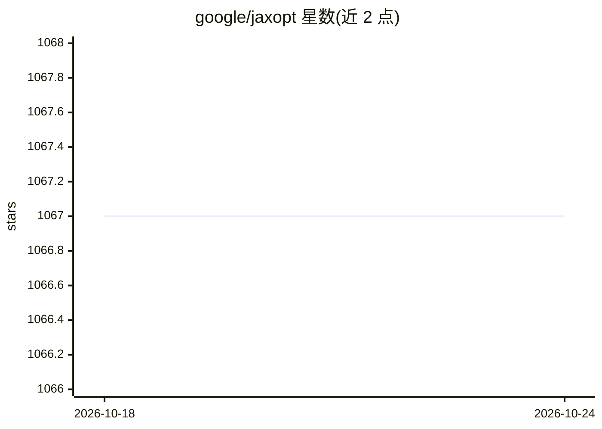

# google/jaxopt

⭐ 1,067 · Python · Apache-2.0 · 推送 2026-10-16 · [GitHub](https://github.com/google/jaxopt) · [官网](https://jaxopt.github.io) · 组织维护

**JAX 生态的硬件加速、可批处理、可微分优化器库（已停维）**

基于 JAX 实现的优化器与隐式微分框架库：提供可在 GPU/TPU/CPU 上运行的优化算法，支持用 vmap 对同一优化问题的多个实例自动向量化，优化解可对输入求导（隐式微分或展开迭代的自微分）。以 Python 包形式经 pip 安装。项目已停止维护与开发，部分功能（losses、projections、lbfgs）已迁移至 optax，替代方案见 JAX 官网。隐式微分框架有配套论文可引用。

## 筛选速览

| 维度 | 判定 | 备注 |
|---|---|---|
| AI 角色 | `ai-native` | 本体是模型或模型工具 |
| 许可风险 | `permissive` | Apache-2.0 |
| 部署形态 | `library` | 以包/库形式分发 |
| 模型依赖 | — | README 未给出锁定关系 |
| 硬件要求 | — | 无带数字的原话,不猜 |
| 安装摩擦 | `low` | 无编译、无系统依赖或容器化 |
| 成熟度 | — | 结构信号不足 |

## 能力要点

- 优化器实现运行于 GPU/TPU/CPU
- 支持 vmap 批处理同一优化问题的多实例
- 优化解可通过隐式微分或展开迭代求导
- 隐式微分框架有配套论文

## 适用场景

- 在 JAX 中求解并微分优化问题
- 科学计算/深度学习中做可微分优化层
- 批量化运行大量同构优化问题

## 场景标签

 · 领域:机器学习/科学计算

## 证据(README 行号)

> L9: Hardware accelerated, batchable and differentiable optimizers in
> L12: - **Hardware accelerated:** our implementations run on GPU and TPU, in addition
> L16: - **Differentiable:** optimization problem solutions can be differentiated with

## 星数曲线

2026-10-18 1,067 → 2026-10-24 1,067（+0）

---
*卡片 v1 · prompt 1.4 · 生成 2026-10-21 · 置信度 high · 依据 README sha `02185fabd39f` · [字段定义](../../DATASET.md)*
