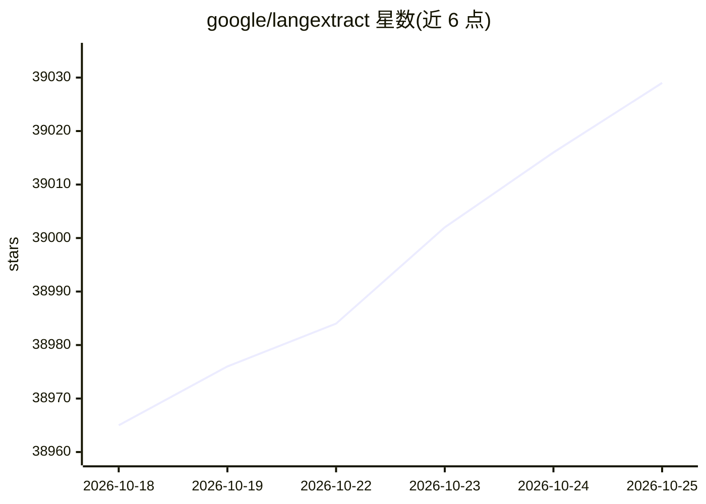

# google/langextract

⭐ 39,029 · Python · Apache-2.0 · 推送 2026-10-17 · [GitHub](https://github.com/google/langextract) · [官网](https://pypi.org/project/langextract/) · 组织维护

**用 LLM 从非结构化文本提取结构化信息并溯源的 Python 库**

LangExtract 是一个 Python 库：按用户自定义指令和 few-shot 示例，用 LLM 从临床笔记、报告等非结构化文本中提取结构化信息。核心机制包括：分块与并行处理长文档、多次抽取提高召回、将每个抽取值锚定回原文精确字符区间，并可生成自包含的交互式 HTML 可视化文件。模型侧支持 Gemini 系列、OpenAI（可选依赖）、经内置 Ollama 接口的本地模型，并提供插件系统接入自定义 provider。云模型需配置 API key；本地模型无需 key。

## 筛选速览

| 维度 | 判定 | 备注 |
|---|---|---|
| AI 角色 | `ai-native` | 本体是模型或模型工具 |
| 许可风险 | `permissive` | Apache-2.0 |
| 部署形态 | `self-host` | docker 或自建部署 |
| 模型依赖 | local-ok | 支持本地模型 |
| 硬件要求 | — | 无带数字的原话,不猜 |
| 安装摩擦 | `low` | 无编译、无系统依赖或容器化 |
| 成熟度 | — | 结构信号不足 |

## 动量与使用信号

- 维护:`active` — 距上次 push 1.0 天,年发版 10,28 位贡献者
- 涨星:近 1 天 **+4**(自 20261016 起算)
- 安装:pypi 包 `langextract` 月下载 359,295
- 平台:— · 协议:OPENAI-API / OLLAMA

## 能力要点

- 抽取值精确锚定到源文本字符区间，支持可视化高亮核验
- 分块+并行+多次抽取策略处理长文档
- 内置 Ollama 支持本地推理，无需 API key
- 轻量插件系统注册自定义模型 provider

## 适用场景

- 从临床笔记或报告中抽取结构化字段并保留原文出处
- 整本小说级长文档的批量实体抽取
- 无 API key 环境下用本地模型做信息抽取
- 生成可视化 HTML 供人工审阅大量抽取结果

## 场景标签

`文档解析` · 领域:知识与检索

## 证据(README 行号)

> L17: LangExtract is a Python library that uses LLMs to extract structured information from unstructured text documents b
> L30: 5. **Flexible LLM Support:** Supports your preferred models, from cloud-based LLMs like the Google Gemini family to

## 星数曲线

2026-10-18 38,965 → 2026-10-25 39,029（+64）

---
*卡片 v1 · prompt 1.4 · 生成 2026-10-18 · 置信度 high · 依据 README sha `a9ab4dadc2b1` · [字段定义](../../DATASET.md)*
