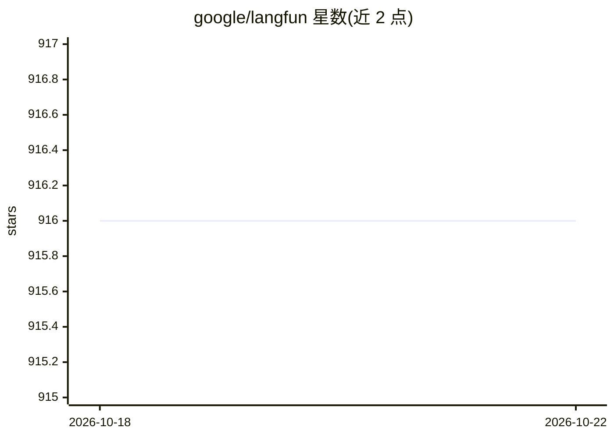

# google/langfun

⭐ 916 · Python · Apache-2.0 · 推送 2026-10-21 · [GitHub](https://github.com/google/langfun) · 组织维护

**面向 LLM 的面向对象提示编程库，用对象与类型构造提示**

Langfun 是基于 PyGlove 的 Python 库，通过 Object-Oriented Prompting 让用户以对象和类型向 LLM 发起提示，将自然语言与程序整合，并支持 agent 开发与评测框架。它在统一 API 下接入 Gemini、GPT、Claude、Llama3 等模型，无需额外微调。安装采用 pip 加 Extras 按需安装机制，最小安装仅依赖 PyGlove、Jinja2 和 requests；可选 vertexai、图像支持等附加功能。README 声明这不是官方支持的 Google 产品。

## 筛选速览

| 维度 | 判定 | 备注 |
|---|---|---|
| AI 角色 | `ai-ecosystem` | LLM/agent 周边工具 |
| 许可风险 | `permissive` | Apache-2.0 |
| 部署形态 | `library` | 以包/库形式分发 |
| 模型依赖 | locked-api |  |
| 硬件要求 | — | 无带数字的原话,不猜 |
| 安装摩擦 | `low` | 无编译、无系统依赖或容器化 |
| 成熟度 | — | 结构信号不足 |

## 能力要点

- Object-Oriented Prompting：以对象和类型构造提示
- 统一 API 接入 Gemini、GPT、Claude、Llama3 等
- 提供评测框架，支持批量任务
- Extras 按需安装，最小依赖仅 PyGlove、Jinja2、requests

## 适用场景

- 在 Python 代码中以结构化对象方式编写 LLM 提示
- 开发基于 LLM 的 agent 与评测流程
- 在请求式工作流与批量任务中使用多种模型

## 场景标签

`提示工程` · 领域:Agent 开发

## 证据(README 行号)

> L16: treating language as functions. Through the introduction of *Object-Oriented Prompting*,
> L37: * Comprehensive LLMs under a unified API: Gemini, GPT, Claude, Llama3, and more.

## 星数曲线

2026-10-18 916 → 2026-10-22 916（+0）

---
*卡片 v1 · prompt 1.4 · 生成 2026-10-21 · 置信度 high · 依据 README sha `c70fd0c9e0f0` · [字段定义](../../DATASET.md)*
