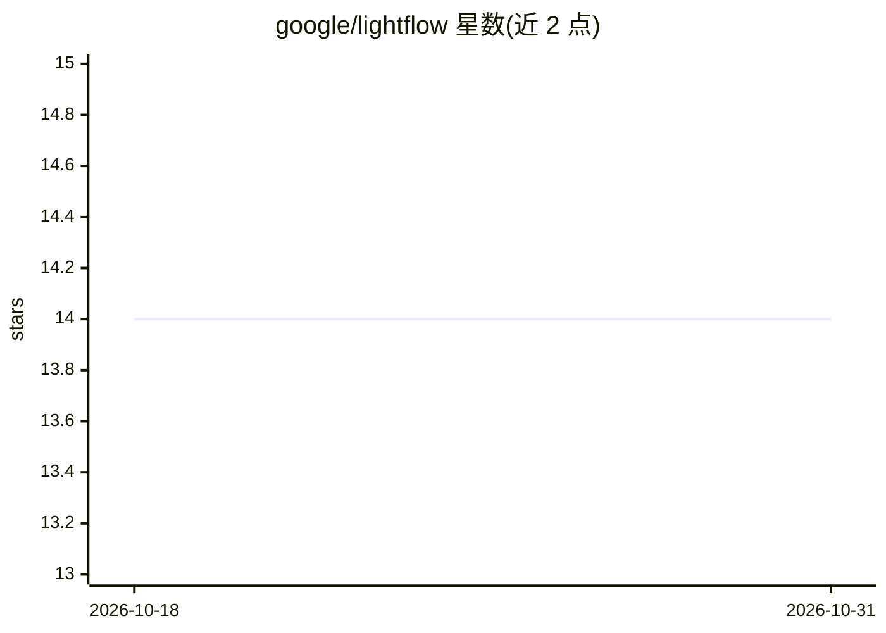

# google/lightflow

⭐ 14 · Python · Apache-2.0 · 推送 2026-10-22 · [GitHub](https://github.com/google/lightflow) · 组织维护

**面向 AI agent 的本地优先 Python DAG 工作流编排与执行引擎**

将 agent 技能中的散文式清单替换为可执行的 YAML DAG：机械步骤编译为 Python 函数（python_action），需人工或 agent 审批的步骤成为检查点（operator_action，以 exit 2 挂起并生成 resume 命令）。中间输出经磁盘上的 passport.json 传递，resume 仅重跑失败子图，支持 JSON Schema 校验、dry_run、重试/回滚/轮询策略。纯 Python 包、无守护进程，供通过 CLI 驱动多步有副作用流程的开发者与 agent 使用。限制：单线程顺序执行、本地文件状态、pre-1.0 接口可能变动。

## 筛选速览

| 维度 | 判定 | 备注 |
|---|---|---|
| AI 角色 | `ai-ecosystem` | LLM/agent 周边工具 |
| 许可风险 | `permissive` | Apache-2.0 |
| 部署形态 | `library` | 以包/库形式分发 |
| 模型依赖 | — | README 未给出锁定关系 |
| 硬件要求 | — | 无带数字的原话,不猜 |
| 安装摩擦 | `low` | 无编译、无系统依赖或容器化 |
| 成熟度 | `idea` | |

## 能力要点

- DAG 编译与确定性拓扑顺序执行，状态存于本地 passport.json
- operator_action 检查点以 exit 2 挂起进程并生成可复制的 resume 命令
- resume 仅重跑失败子图，已完成上游阶段不重复执行
- 支持 JSON Schema 门校验、dry_run 验证、retry/rollback/polling 策略

## 适用场景

- 把多步有副作用的 agent 流程从散文清单改为可恢复的 DAG
- 在流程中插入人工或 agent 审批检查点后再继续执行
- 跨多次 CLI 调度或压缩后的会话恢复中断的工作流

## 场景标签

`工作流自动化` · 领域:效率与自动化

## 证据(README 行号)

> L1: # Lightflow: Deterministic DAG Workflow Engine for AI Agents
> L5: **Lightflow** replaces the prose checklist with an executable DAG (`lightflow.yaml`). Mechanical steps become Python
> L42: Lightflow is a pure-Python package (`PyYAML` and `jsonschema`, with stdlib fallbacks from a checkout) with no serve

## 星数曲线

2026-10-18 14 → 2026-10-31 14（+0）

---
*卡片 v1 · prompt 1.4 · 生成 2026-10-31 · 置信度 mid · 依据 README sha `725a55f2eef8` · [字段定义](../../DATASET.md)*
