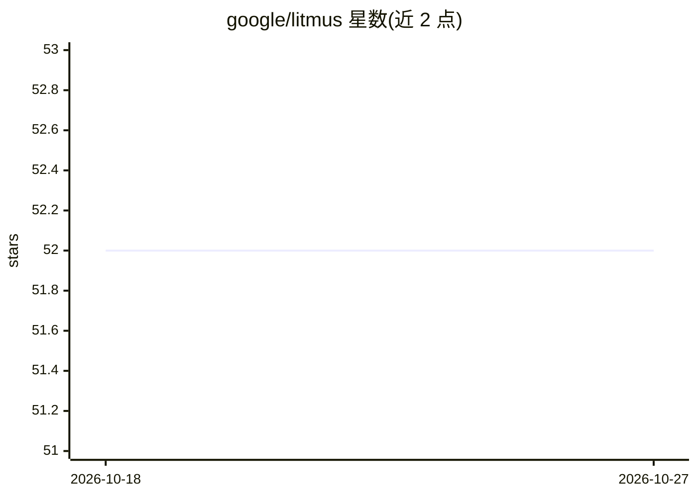

# google/litmus

⭐ 52 · Vue · Apache-2.0 · 推送 2026-03-29 · [GitHub](https://github.com/google/litmus) · [官网](https://google.github.io/litmus/) · 组织维护

**面向 GenAI 应用的 LLM 测试与评估平台**

由四部分组成的 LLM 测试评估工具：API、Worker 服务、Web 界面与可选代理服务。通过预定义模板（单轮 Test Run / 多轮 Test Mission）执行自动化测试，用 LLM 将实际响应与黄金答案比对，并支持 Ragas 与 DeepEval 的评估指标（忠实度、幻觉、毒性等）。代理服务作为 LLM 客户端与上游提供商之间的中介记录请求响应日志。部署依赖 Google Cloud（Firestore、Cloud Run、BigQuery、Vertex AI），运行会产生云费用。

## 筛选速览

| 维度 | 判定 | 备注 |
|---|---|---|
| AI 角色 | `ai-ecosystem` | LLM/agent 周边工具 |
| 许可风险 | `permissive` | Apache-2.0 |
| 部署形态 | `None` |  |
| 模型依赖 | — | README 未给出锁定关系 |
| 硬件要求 | — | 无带数字的原话,不猜 |
| 安装摩擦 | `low` | 无编译、无系统依赖或容器化 |
| 成熟度 | — | 结构信号不足 |

## 能力要点

- 模板化自动化测试：单轮 Test Run 与多轮 Test Mission
- 三种评估方法：自定义 LLM 评估、Ragas、DeepEval
- 可选代理服务捕获 LLM 请求/响应日志并送入 BigQuery
- 提供 CLI 快速部署到 Google Cloud Run

## 适用场景

- 对 LLM 应用响应做批量测试并与黄金答案比对
- 用 Ragas/DeepEval 指标评估 RAG 回答质量
- 通过代理服务监控与记录 LLM 调用情况

## 场景标签

`模型评测` `LLM 可观测性` · 领域:评测与运维

## 证据(README 行号)

> L15: - **Automated Test Execution:** Submit test runs using pre-defined templates to evaluate responses against golden a
> L45:  - Invokes the LLM and compares its responses against golden answers using customizable prompts and other evaluatio

## 星数曲线

2026-10-18 52 → 2026-10-27 52（+0）

---
*卡片 v1 · prompt 1.4 · 生成 2026-10-24 · 置信度 high · 依据 README sha `483c84fb00e7` · [字段定义](../../DATASET.md)*
