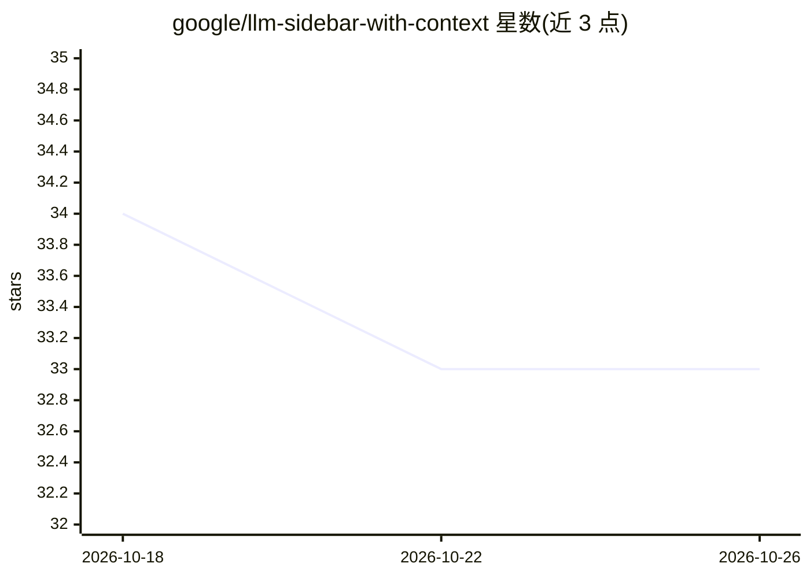

# google/llm-sidebar-with-context

⭐ 33 · TypeScript · Apache-2.0 · 推送 2026-09-10 · [GitHub](https://github.com/google/llm-sidebar-with-context) · 组织维护

**把多个浏览器标签内容作为上下文与 LLM 对话的 Chrome 侧边栏扩展**

纯前端运行的 Chrome 扩展：在侧边栏与 Gemini、本地 Ollama 或 OpenRouter 三种提供方对话，可固定最多 6 个标签页（含 YouTube、Google Docs、普通网页）的内容作为提示上下文，并支持动态分享当前标签。请求直接从浏览器发送到所选 API，无中间服务器；API key 与聊天记录存储在本地 chrome.storage。通过 Chrome 应用商店安装，或 npm 构建后以开发者模式加载 dist 目录。

## 筛选速览

| 维度 | 判定 | 备注 |
|---|---|---|
| AI 角色 | `ai-native` | 本体是模型或模型工具 |
| 许可风险 | `permissive` | Apache-2.0 |
| 部署形态 | `library` | 以包/库形式分发 |
| 模型依赖 | local-ok | 支持本地模型 |
| 硬件要求 | — | 无带数字的原话,不猜 |
| 安装摩擦 | `low` | 无编译、无系统依赖或容器化 |
| 成熟度 | — | 结构信号不足 |

## 能力要点

- Gemini / 本地 Ollama / OpenRouter 三种提供方可选
- 固定最多 6 个标签页作为对话上下文（YouTube/Docs/网页多模态提取）
- 纯前端运行，请求不经中间服务器，密钥与历史存于浏览器本地
- Ollama 支持列出主机模型、测试连接、配置 num_ctx 与 keep_alive

## 适用场景

- 浏览网页时在侧边栏对当前页面内容提问或总结
- 结合多个标签页资料做跨页面问答
- 用本地 Ollama 模型进行不经外部网络的私密对话

## 场景标签

`文档问答` `聊天机器人` · 领域:对话与助手

## 证据(README 行号)

> L3: This Chrome Extension allows you to interact with Gemini, a local Ollama model, or an OpenRouter model in a sidebar,
> L17: - **Frontend Only:** This extension runs entirely in your browser. There is no middle-man server; your prompts are 
> L18: - **Context-Aware Chat:** Pin up to 6 tabs to use their content as context for your prompts.

## 星数曲线

2026-10-18 34 → 2026-10-26 33（-1）

---
*卡片 v1 · prompt 1.4 · 生成 2026-10-25 · 置信度 high · 依据 README sha `78ea76c6ce3e` · [字段定义](../../DATASET.md)*
